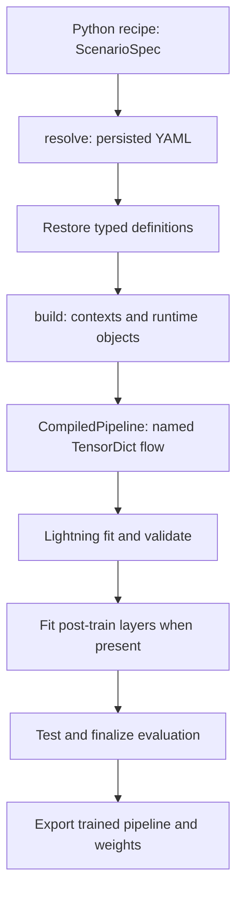

NexuML separates immutable semantic configuration from mutable execution objects.
Reusable implementations live in libraries; one scenario composes an experiment.
This page follows the synthetic reconstruction example from the
[first run](/start/first-run/) through every boundary.



## Scenarios

A Python recipe returns `ScenarioSpec`, the composition root. The synthetic recipe
combines `DataSpec` with generated vectors, a `PipelineSpec` with encoder/decoder/loss
stages, `TrainingSpec` with a reconstruction-loss objective, and `EvaluationSpec`.
Scenarios can also select logging, callbacks, tuning, checkpoint/weight-loading policy,
exports, and execution placement. See [configuration reference](/reference/scenario-spec/)
for exact fields; [create/run](/how-to/run-scenarios/#define-a-recipe) owns the procedure.

Within a stage, `LayerSpec` separates component semantics from graph wiring:

```python
LayerSpec(
    component=LinearEncoder(hidden_dims=[64, 32], output_dim=8),
    keys_in=["features"],
    keys_out=["latent"],
)
```

`LinearEncoder` is the concrete Pydantic definition with defaults, validation, and schema.
`LayerSpec` says where it runs and which keys it consumes/produces. Data sources,
evaluation algorithms, loader backends, and execution backends use the same typed-definition
pattern. Definitions are frozen portable values: no loaded tensors, modules, dataset
state, trainer state, or shared storage.

For a normal importable module with one tensor input and output, use the core definition:

```python
import torch
from nexuml import nn_module
from nexuml.core.types import LayerSpec

projection = LayerSpec(
    component=nn_module(torch.nn.Linear, 128, 8),
    keys_in=["features"],
    keys_out=["latent"],
)
```

This illustrates an alternative encoder, not a change to the first-run recipe.
Use a registered semantic definition when behavior needs labels, metadata, build context,
custom lifecycle, or richer input/output routing. See [custom layers](/how-to/custom-layer/).

## Persist definitions, not runtimes

`nexuml resolve synthetic-linear-ae-reconstruction --output configs/first-run.yaml`
evaluates the registered recipe, compiles it, and saves its resolved configuration.
At YAML/checkpoint boundaries, generic lowering replaces each registered definition
with stable data:

```yaml
component:
  type: LinearEncoder
  version: '1'
  params:
    hidden_dims: [64, 32]
    output_dim: 8
```

Restoration discovers the definition, performs exact kind/name/version lookup,
and calls `definition_type.model_validate(params)`. The common `ComponentRegistry`
owns lookup, reverse lookup, deterministic listing, and conflict diagnostics—not runtime
constructor inspection or parameter validation. Scenario functions have a separate recipe registry.
Normal Python imports concrete definitions directly rather than resolving strings.

Registered semantic definitions persist no concrete Python import path. `NnModule`
and typed external factory helpers are the explicit external-code exception: they store
an importable top-level `module:name` target and recursively JSON-safe constructor values.
Compilation imports/invokes that target; live instances, closures, lambdas, local definitions,
and constructor reflection are not supported. **Resolved config is trusted code input,
not a sandbox.**

## Materialize explicitly

`nexuml build configs/first-run.yaml` restores the definitions, propagates shapes/key
metadata, and calls explicit build boundaries:

| Definition boundary | Runtime result |
| --- | --- |
| `LayerDefinition.build(LayerBuildContext)` | `PipelineLayer` |
| `DataSourceDefinition.build()` | `NexuDataset` |
| `EvalAlgorithmDefinition.build(EvalBuildContext)` | `EvalAlgorithm` |
| `LoaderBackendDefinition.build()` | loader backend |

Layer context supplies inferred input shapes, TensorDict keys, labels/class count,
metadata, shared storage, and scheduling. The compiler calls `spec.component.build(context)`
directly; normal Python compilation does not resolve layer names or inspect `__init__`.
Public definitions and private runtime implementations are usually colocated.
`NnModuleLayer.build()` constructs only the explicit factory arguments and wraps the
result in `TorchModuleAdapter`.

Build checks many missing-key/shape errors using dummy propagation; it executes
constructors and dummy forwards, not just schema validation. Diagram export is optional,
and the first-run recipe does not enable it.

## Tensor data flow

`TensorDict` is the shared named container, avoiding an opaque positional tensor chain.
For the reconstruction example, the original `features` remain available while later
stages add `latent`, `reconstructed`, and `reconstruction_loss`:

```text
features [batch, 128]
  ├─ Encoder → latent [batch, 8]
  │               └─ Decoder → reconstructed [batch, 128]
  └─────────────────────────── Loss → reconstruction_loss
```

`keys_in`/`keys_out` are runtime read/write contracts, not display names.
The compiled pipeline executes ordered stages and layers, routing their named values.
Heads, losses, metrics, evaluation, and exports can reuse intermediates without rebuilding
the model. TensorDict also moves/slices related tensors together.

Data loaders generally return `(x: TensorDict, y: TensorDict | None)`. The pipeline primarily
transforms `x`; labels may remain in `y` and enter layers through `label_key` and related
routing. For example, a classifier can consume `latent` and a separately routed class label.
The synthetic reconstruction path only needs the original and reconstructed features.

## Lightning, evaluation, and outputs

`NexuSession` wraps the pipeline in `NexuLightningModule` and constructs a `NexuDataModule`.
The normal lifecycle is **fit → validate → fit unfitted post-train layers → test**.
Lightning owns devices, precision, strategies, callbacks, optimizer/scheduler state,
and trainer resume. `TrainingSpec.loss_keys` weights pipeline losses; `metric_keys`
selects emitted pipeline metrics.

Post-train fitted pipeline layers produce model outputs using learned state.
Evaluation algorithms instead consume test outputs, finalize, visualize when configured,
and return reporting scalars. `EvaluationSpec.test_result_metrics` controls their selected
test-result exposure. There is no standalone `nexuml evaluate` command.
See [evaluation](/how-to/evaluate/) for the focused contract.

Local/Ray/native jobs change placement, not the model API. Distributed stateful evaluation
and post-train fitting remain deliberately restricted where global finalization is unsupported.
See [execution modes](/how-to/training-backends/).

Logging, checkpoint callbacks, and requested exports determine actual files. No single
hard-coded checkpoint tree applies to all scenarios. An export package contains the compiled
pipeline, resolved config, weights, provenance, and runtime dependency information.
`load_package` reconstructs with installed code; `load_inference_package` loads the packaged
pipeline directly. Custom source nested in `TorchModuleAdapter` is packaged, while PyTorch
and other heavy dependencies stay external. Use an actual checkpoint or a live trained
pipeline when exporting trained weights. See [export/reload](/how-to/export/).

## Coming from Lightning

NexuML does not replace Lightning's loop; it makes experiment composition, persistence,
data flow, and reusable libraries explicit around that loop.

| PyTorch / Lightning | NexuML |
| --- | --- |
| `torch.nn.Module` blocks | runtime `PipelineLayer` from a definition or `nn_module(...)` |
| one model graph | `CompiledPipeline`, ordered stages and named keys |
| custom `LightningModule` | session-created `NexuLightningModule` |
| `LightningDataModule` | `NexuDataModule` from `DataSpec` and loader definition |
| `Trainer(...)` settings | `TrainingSpec`, typed factories, `LoggingSpec` |
| `ModelCheckpoint(...)` | `callback(ModelCheckpoint, ...)` |
| `Trainer.fit(..., ckpt_path=...)` | `--trainer-checkpoint PATH` |
| pretrained initialization | `CheckpointLoadSpec` |
| training script | `ScenarioSpec` and `nexuml train` |
| hand-maintained experiment YAML | validated output of `nexuml resolve` |

`callback(...)` captures an importable callback and its constructor values; runtime
construction happens at training. `training.strategy` remains authoritative, including
mapping supported Ray choices to Ray's official Lightning strategies.

Keep three checkpoint operations distinct: **create** with a callback; **resume** full
trainer/model/optimizer/scheduler/epoch/callback state with `--trainer-checkpoint`; **reuse**
selected weights or freeze parameters with `CheckpointLoadSpec` without resuming trainer state.
See [checkpoint examples](/how-to/checkpoints/).

## Ownership and source map

| Concern | Owner / implementation |
| --- | --- |
| Experiment composition and routing | specs in `nexuml.core.types` |
| Component semantics/validation | concrete definition in `nexuml.core.components` and libraries |
| Identity/discovery | `nexuml.core.registry`, `nexuml.core.discovery` |
| YAML/checkpoint conversion | `nexuml.core.serialization`, `nexuml.core.config` |
| Build contexts, shapes, runtime graph | `nexuml.core.compiler`, `nexuml.core.pipeline` |
| Mutable lifecycle | `nexuml.training.lightning` |
| Portable artifacts | `nexuml.core.export` |

Read the [generated types API](/reference/api/nexuml/core/types/),
[library/discovery guide](/how-to/custom-library/#discovery), or
[trusted-file procedure](/how-to/scenario-file/) when you need those boundaries.
For purpose/current scope versus direction, see [Why NexuML](/explanation/why-nexuml/).
