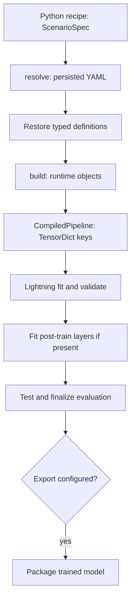

NexuML keeps **reusable implementations in libraries** and **experiment composition
in scenarios**, separating portable definitions from mutable training objects.
The [first CPU run](/start/first-run/) demonstrates the commands; this page
explains the boundaries.



## Scenarios

A Python recipe returns `ScenarioSpec`, combining data, pipeline, training,
and optional evaluation, logging, callbacks, tuning, checkpoint, exports,
and execution policy. The [scenario guide](/how-to/run-scenarios/#define-a-recipe)
owns runnable examples; [typed reference](/reference/scenario-spec/) owns fields.

Inside `PipelineSpec`, `LayerSpec` describes where a component runs and which
named keys it reads and writes:

```python
LayerSpec(
    component=LinearEncoder(hidden_dims=[64, 32], output_dim=8),
    keys_in=["features"],
    keys_out=["latent"],
)
```

`LinearEncoder` is an immutable, validated semantic definition; `LayerSpec`
owns the routing. Mutable tensors, modules, dataset handles, and accumulators
belong to private runtimes. Data sources, loaders, and evaluation algorithms
follow the same definition-to-runtime pattern.

Ordinary importable PyTorch modules can use [`nn_module(...)`](/how-to/custom-layer/#prefer-a-direct-module)
instead of a custom definition. Register richer behavior only when it needs
NexuML-specific context, lifecycle, or routing.

## Persist definitions, not runtimes

`nexuml resolve` validates/compiles a recipe and writes explicit YAML. A
registered component persists a stable identity and parameters, not its
Python runtime:

```yaml
component:
  type: LinearEncoder
  version: '1'
  params:
    hidden_dims: [64, 32]
    output_dim: 8
```

Restoration discovers the matching kind/name/version and validates the parameters.
The [registry guide](/how-to/custom-library/#discovery) covers identities,
discovery failures, and library installation. External factories are an
exception: their importable Python target and JSON-safe constructor arguments
are recorded explicitly. **Resolved configurations execute trusted code;
they are not a sandbox.**

## Materialize explicitly

`nexuml build` restores definitions and calls explicit build methods:

| Definition | Runtime |
| --- | --- |
| `LayerDefinition.build(LayerBuildContext)` | `PipelineLayer` |
| `DataSourceDefinition.build()` | `NexuDataset` |
| `EvalAlgorithmDefinition.build(EvalBuildContext)` | `EvalAlgorithm` |
| `LoaderBackendDefinition.build()` | loader backend |

Build contexts supply inferred shapes, keys, labels, and metadata rather
than storing them in semantic definitions. Compilation performs constructor
and dummy-forward checks; it is more than YAML validation. [Diagram output](/explanation/diagrams/)
is optional.

## Tensor data flow

`TensorDict` connects named inputs and outputs so stages can reuse intermediates.
In the synthetic example:

```text
features [batch, 128]
  ├─ Encoder → latent [batch, 8]
  │               └─ Decoder → reconstructed [batch, 128]
  └─────────────────────────── Loss → reconstruction_loss
```

`keys_in`/`keys_out` are read/write contracts, not display labels.
Loaders generally supply `(x: TensorDict, y: TensorDict | None)`;
the pipeline transforms `x` while labels can be routed from `y`.
The compiler checks missing keys and shapes where possible.

## Lightning, evaluation, and outputs

`NexuSession` constructs `NexuLightningModule` and `NexuDataModule`,
then runs **fit → validate → fit post-train layers → test**. Lightning owns
devices, strategies, precision, optimization, callbacks, and full trainer resume.
`TrainingSpec.loss_keys` and `metric_keys` select emitted pipeline values.

Post-train pipeline layers learn model state; evaluation algorithms accumulate
reporting results and optionally visualize them. There is no separate top-level
`nexuml evaluate` command. See [evaluation](/how-to/evaluate/).

Logging, checkpoint callbacks, and exports are **explicit options**, not
guaranteed artifacts. Export can package a trained pipeline and weights;
[reload/inference](/how-to/export/) documents installed-code versus packaged-code
loading. Local, Ray, and native jobs share the model API, but distributed
post-train/evaluation finalization has [restrictions](/how-to/training-backends/ray/).

## Coming from Lightning

NexuML keeps Lightning's trainer while making composition and persistence explicit.

| PyTorch / Lightning | NexuML |
| --- | --- |
| `torch.nn.Module` | `PipelineLayer` or `nn_module(...)` |
| model graph | `CompiledPipeline` with named keys |
| custom `LightningModule` / `DataModule` | session-created modules from typed specs |
| `Trainer(...)` settings | `TrainingSpec` and factories |
| training script | `ScenarioSpec` plus `nexuml train` |
| `ModelCheckpoint(...)` | `callback(ModelCheckpoint, ...)` |
| `Trainer.fit(..., ckpt_path=...)` | `--trainer-checkpoint PATH` |
| pretrained initialization | `CheckpointLoadSpec` |

Keep **create**, **full trainer resume**, and **selective weight reuse** distinct;
see [checkpoint examples](/how-to/checkpoints/).

## Ownership and source map

Definitions and routing live in [`nexuml.core.types`](/reference/api/nexuml/core/types/);
discovery in [`nexuml.core.discovery`](/reference/api/nexuml/core/discovery/);
materialization in [`nexuml.core.compiler`](/reference/api/nexuml/core/compiler/);
training in [`nexuml.training.lightning`](/reference/api/nexuml/training/lightning/);
and packaging in [`nexuml.core.export`](/reference/api/nexuml/core/export/).
For purpose and product boundaries, read [Why NexuML](/explanation/why-nexuml/).
