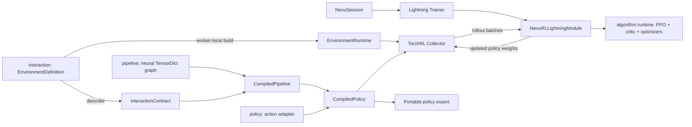

RL uses the ordinary `NexuSession` and Lightning trainer. TorchRL supplies collection,
GAE and clipped PPO losses; NexuML does not add another trainer.

For a state-only native GPU learning example rather than a wiring smoke test, use
[Train state-only Isaac Cartpole](/how-to/isaac-cartpole/): one declarative scenario file,
private read-only Viser, automatic policy export and fresh-process evaluation.

## Ownership and mental model



- **`pipeline`** is the trainable neural graph. Its existing `forward(x, y)` contract is unchanged.
- **`policy`** turns neural outputs into valid actions. `CompiledPolicy` combines the graph,
  adapter and portable I/O contract. Gaussian inference uses a bounded transform;
  categorical inference chooses a mode or samples. Both use base PyTorch for deployment.
- **`interaction`** describes observations/actions and owns environment definitions, not live handles.
  Field shapes exclude batch dimensions; dtype, modality, bounds and control rates are explicit.
  `describe()` never connects to ROS/CARLA. Gymnasium may briefly probe spaces and immediately close.
- **`training`** selects learning semantics. PPO owns its critic, losses and optimizer configuration;
  Lightning owns precision, optimization execution and checkpoints.
- **Live environments/collectors** are built at execution sites, consumed through an iterable with
  `batch_size=None, num_workers=0`, and shut down on completion or failure. Remote collectors
  receive definitions/factories, not live simulator handles.

`total_frames` is the finite budget; `frames_per_batch` is the rollout batch size.
PPO `update_epochs` repeats updates within a batch, not dataset epochs. Batch boundaries
can round the final frame count. Evaluation builds a fresh environment and reports episode
return mean/std, mean length, termination and truncation counts. Set
`interaction.evaluation_environment` to override the evaluation definition.

## Fast CPU round trip

From the repository root, with Python 3.12 or newer:

```bash
uv venv --python 3.12
source .venv/bin/activate
uv pip install -e ".[reinforcement]" -e "./library[reinforcement]"
export CUDA_VISIBLE_DEVICES=''
export OMP_NUM_THREADS=1 MKL_NUM_THREADS=1
export NEXUML_RL_DEMO=/tmp/opencode/nexuml-rl-demo
export NEXUML_LOGS_ROOT="$NEXUML_RL_DEMO/logs"
mkdir -p "$NEXUML_RL_DEMO"
nexuml registry list scenarios

for SCENARIO in pendulum-ppo cartpole-ppo; do
  nexuml resolve "$SCENARIO" --output "$NEXUML_RL_DEMO/$SCENARIO.yaml"
  nexuml train --config "$NEXUML_RL_DEMO/$SCENARIO.yaml" \
    -O training.total_frames=32 -O training.frames_per_batch=16 \
    -O training.algorithm.update_epochs=1 -O training.algorithm.minibatch_size=8 \
    -O training.evaluation.episodes=1 -O training.evaluation.max_steps_per_episode=8

  # Discover the actual newest checkpoint; do not assume a version_0 path.
  CHECKPOINT=$(python -c 'import os; from pathlib import Path; print(max(Path(os.environ["NEXUML_LOGS_ROOT"]).rglob("*.ckpt"), key=lambda p: p.stat().st_mtime))')
  printf 'Checkpoint: %s\n' "$CHECKPOINT"
  nexuml export "$SCENARIO" --checkpoint "$CHECKPOINT" \
    --output "$NEXUML_RL_DEMO/$SCENARIO-policy"
  nexuml evaluate "$NEXUML_RL_DEMO/$SCENARIO-policy" \
    -O training.evaluation.episodes=1 -O training.evaluation.max_steps_per_episode=8
  nexuml train --trainer-checkpoint "$CHECKPOINT"
done
```

Both references enable the native TensorBoard logger; MLflow, initial/periodic evaluation
and recording are off by default. The commands produce training events/checkpoints,
complete policy packages, scalar replay results and replay provenance in a separate native
evaluation run. The last command demonstrates checkpoint restoration: this completed
32-frame checkpoint has no remaining learning budget. For interruption recovery, pass an
intermediate checkpoint instead; see [Checkpoints](/how-to/checkpoints/) for batch-level saving.
These tiny runs test updates and artifact wiring, not task convergence or policy quality.

Use [resolved YAML](/how-to/run-scenarios/) and ordinary repeatable `-O` overrides, not user
source edits. For Python exports, deploy `export_package(result.policy, path)`, not
`result.pipeline`: raw Gaussian parameters are not environment actions. The existing
dataset-oriented `smoke` command is not an RL acceptance path.

## Optional robotics dependencies

The Physical AI dependency group is `nexuml[robots]` (forwarded to
`nexuml-library[robots]`), deliberately **not** included in `all`. It selects
Isaac Lab/Sim, standalone physics, robot datasets and small imitation-policy
dependencies. It does not download pretrained model weights or establish native
support merely by installing. Meta-World's incompatible native selection remains
separate rather than hidden inside this group.

Published requirements declare compatibility minimums, not our development
Python/CUDA/Torch pins. The consuming uv project's root selects native sources,
wheel indexes, approved overrides and a reproducible lock. This repository's
`tool.uv` configuration is its standalone Python-3.12/cu130 validation selection;
it is not inherited by downstream packages. The current Isaac Lab 3 source
selection needs the pinned upstream aggregate-wheel builder until an appropriate
release wheel is published. Other consumers must select a compatible native
source themselves; genuine upstream wheel/API/ABI constraints still apply.

The standalone validation selection currently carries temporary consumer-root
exceptions for packaging, Transformers, NumPy, urllib3 and USD. Sim's Requests
2.32.3 pin is replaced with patched 2.34.2; the published core minimum 2.32.4
excludes the known `.netrc` credential leak (CVE-2024-47081). LeRobot 0.6.1 uses
Sim's no-FFmpeg OpenCV distribution via a narrowly scoped replacement so two
packages cannot overwrite the same `cv2` files. These exceptions require
affected-workflow validation, not just a successful solver or import. Preserve
the original dependency-check output and fail on unexpected discrepancies;
remove each exception once a maintained compatible selection works normally.
The root-only default `native-sources` group binds Sim's MuJoCo USD converter
to PyPI rather than NVIDIA's older mirror and selects CUDA wheel indexes only
for standalone development. Editable consumers do not inherit that group's
backend selection; both wheel and editable installs keep consumer authority.

For this repository, with an isolated environment selected explicitly:

```bash
UV_PROJECT_ENVIRONMENT="$PWD/.venv" VIRTUAL_ENV="$PWD/.venv" \
  uv sync --extra dev --extra all --extra robots
```

The broader NexuVibe consumer additionally selects its backend and development
dependencies. Never run a setup command against an active shared environment
just to test robotics integration. Native prerequisites and asset/license checks
remain separate; large foundation-model experiments are deferred in the current
Isaac-first campaign.

## Initial, periodic and final evaluation

```bash
nexuml train cartpole-ppo \
  -O training.total_frames=32 -O training.frames_per_batch=16 \
  -O training.algorithm.update_epochs=1 -O training.algorithm.minibatch_size=8 \
  -O training.evaluation.episodes=1 -O training.evaluation.max_steps_per_episode=8 \
  -O training.evaluation.at_start=true -O training.evaluation.every_n_frames=16
```

`at_start` defaults to `false`; `every_n_frames` defaults to `null`. With these and video
disabled, plain `fit()` and final-only `run()` behavior stay unchanged. Opted-in runs log
initial/progress/final metrics while the existing native loggers are active. Final evaluation
is reused rather than repeating the same episodes/media when `run()` collects its result.

Cadence counts **collected training frames**, not PPO optimizer/global steps. A batch that
crosses an interval triggers once at its actual frame count, even if it crosses several
intervals; there is no historical catch-up. Resume derives the next future interval from
restored frames and does not repeat frame-zero evaluation. Final evaluation also runs for
an off-interval end or a checkpoint with no remaining batches. Evaluation is synchronous:
more episodes, longer horizons and more frequent checks cost wall time/storage.

Each evaluation owns a fresh single environment, never resets the training collector, and
restores policy modes and random streams. `training.evaluation.seed` falls back to
`training.seed` on the legacy RL path; episode seeds increment from that seed. The default deterministic action
mode and a fixed seed make CPU comparisons useful, not a cross-platform determinism promise.
`episodes=0` disables scalar episodes without allocating an environment; recording then
fails validation. Evaluation-environment overrides must retain compatible observation/action
fields and action semantics.

Task outcomes are separate from return. A provider may report boolean `task_success`
alone, or also a finite nonnegative floating `joint_error_rad`. Evaluation emits
`eval/rl/task_success_rate` using any-step success once per episode; it emits
`eval/rl/final_joint_error_rad_mean` only when measured joint error is supplied.
No-outcome tasks keep their existing return/length/end metrics. The outcome signature
(absent, success-only or paired) must stay consistent across steps and episodes.

The Gymnasium provider normalizes native `info["success"]` scalar booleans or finite
numeric zero/one to boolean tensors on the runtime device. Malformed flags, missing
outcomes in some batch rows, and changing presence fail rather than inventing failure
values. Other native `info` is not copied into observations or portable policy state.
This supports success-only task reporting; it does not establish Meta-World native
training or benchmark compatibility without that reference's separate acceptance.

### Episode evaluation without RL training

`ScenarioSpec.policy_evaluation` optionally reuses `RLEvaluationSpec` for any
complete policy, including one trained with the ordinary dataset `TrainingSpec`.
It is separate from the existing dataset `evaluation` block. Keep the original
training mode; do not add a PPO algorithm merely to evaluate an offline model.

For an already assembled `policy` and its matching `scenario`:

```python
from nexuml.core.types import RLEvaluationSpec
from nexuml.training.reinforcement import evaluate_policy

scenario.policy_evaluation = RLEvaluationSpec(
    episodes=3, seed=0, max_steps_per_episode=120,
)
metrics = evaluate_policy(policy, scenario)
```

The scenario must declare its `policy` and `interaction.environment`; an
`interaction.evaluation_environment`, when present, takes precedence. Contracts
are checked before constructing that fresh environment. The episode runner does
not construct a session, learner, optimizer or collector. A supplied
`policy_evaluation` block is authoritative, including on RL scenarios. Only old
RL scenarios without it use `training.evaluation` and its training-seed fallback.
On the explicit path, `seed=0` is preserved and `seed=None` means unseeded; it
never inherits another training seed. Episode seeds increment only when seeded.

The explicit block serializes with the original scenario and complete policy
package. Its `episodes=0` allocates no runtime; missing offline evaluation inputs
produce an error instead of inventing RL settings. Existing `eval/rl/*` metric
names remain unchanged for logger compatibility. The same bounded recording
options require a media sink and working renderer. During RL training, schedule,
cache and provider preflight also use the authoritative block; Isaac's
fresh-process-only restriction cannot be bypassed through it.

The ordinary CLI also accepts complete offline policy packages with their
original `TrainingSpec` and explicit episode block:

```bash
nexuml evaluate /approved/local/complete-policy \
  -O policy_evaluation.episodes=3 -O policy_evaluation.seed=0 \
  -O policy_evaluation.max_steps_per_episode=120
```

Use `policy_evaluation.video.*` for recording such a package. If an otherwise
complete offline package has no episode block, supply a whole
`-O 'policy_evaluation={"episodes":3,"seed":0,"max_steps_per_episode":120}'`
override. This also explicitly switches a legacy RL package to the new path.
Nested overrides cannot traverse an absent block. Mixing new and legacy
evaluation override paths is rejected before logger/runtime creation. With an
embedded explicit block, `training.evaluation.*` overrides are rejected rather
than silently ignored. Legacy RL packages without the new block retain their
existing override path and seed fallback.

This support does not establish ACT, VLA or stateful policy integration. Those
model, preprocessing, training and closed-loop gates remain independent.
Dataset-trained complete-policy assembly remains a separate implementation slice.

## Record GIF, MP4 or both

GIF needs only the scoped rendering extra. Silent H.264 MP4 (or both formats) adds video:

```bash
uv pip install -e "./library[rendering]"  # GIF + classic-control rendering
uv pip install -e "./library[video]"      # GIF + ImageIO/FFmpeg MP4
export SDL_VIDEODRIVER=dummy

for SCENARIO in pendulum-ppo cartpole-ppo; do
  for FORMAT in gif mp4 both; do
    nexuml evaluate "$NEXUML_RL_DEMO/$SCENARIO-policy" \
      -O training.evaluation.episodes=2 -O training.evaluation.seed=7 \
      -O training.evaluation.max_steps_per_episode=16 \
      -O training.evaluation.video.enabled=true \
      -O training.evaluation.video.format="$FORMAT" \
      -O training.evaluation.video.max_frames=12 \
      -O training.evaluation.video.max_size=128
  done
done
```

The same `training.evaluation.video.*` overrides work with `train`, including initial and
16-frame periodic checks. Recording requests `rgb_array` at environment construction;
**Pendulum and CartPole still feed vectors to the policy**, not images. Only the first
episode is captured. Other episodes, and steps after capture stops, still contribute full
metrics. This does not set `image_shape` or convert a state policy into a visual policy.

Evaluation summaries identify the full episode denominator, measured successes
(when the task supplies them), per-group/agent returns and source physical frames.
`native_truncated` reports the environment's truncation flag, **not a proven timeout**;
`evaluation_horizon_limits` counts episodes stopped only by the evaluator's horizon.
The existing `truncated` metric retains its combined meaning. Action violations are
not relabelled as rejected actions; absent rejection measurements remain unavailable.
Recording is labelled first-episode-only, never aggregate evidence of success.

| Setting under `training.evaluation.video` | Default | Meaning |
| --- | --- | --- |
| `enabled` | `false` | Explicit capture/encoding opt-in |
| `format` | `gif` | Downloadable `gif`, `mp4`, or `both` |
| `max_frames` | `500` | Positive cap, including reset and terminal frame if within cap |
| `max_size` | `256` | Positive maximum captured edge; aspect ratio preserved before buffering |
| `fps` | `null` | Renderer FPS; otherwise supply a finite positive override |

For example, `-O training.evaluation.video.fps=25` explicitly sets playback timing. GIF
timing is quantized to centiseconds. MP4 uses H.264/yuv420p, no audio, and at most one padded
pixel per axis for even encoded dimensions, without stretching/cropping or implicit
macroblock scaling. JSON records timing, bounds, captured count and any padding. One
bounded rollout buffer feeds all selected formats/backends; MP4-only does not create a
downloadable GIF. TensorBoard additionally gets a GIF preview even for MP4-only selection.

Native artifacts use `evaluation/frame_<frame-step>.gif`, `.mp4` and `.json`; only selected
downloadable media formats are written. TensorBoard's **Images** tab shows the animated
`eval/rl/episode` preview at collected-frame steps; open MP4 artifacts in a standard player.
Media JSON includes metrics, seed/horizon/mode, environment/config/contract provenance,
FPS, capture limits and encoder/dimension information. Native relative paths are prefixed
by `NEXUML_LOGS_ROOT` (including the default `.experiments/tensorboard` path):

In **Images**, choose the exact run and `eval/rl/episode` card. Focus its step
slider: **Home** selects the first retained event and **Right Arrow** advances to
the next event, not the next physical frame. Check the displayed **Step** label;
for a retained 0/32/64 sequence the slider positions are 0/1/2. Reopen the retained
log directory after training exits; reopening does not retrain the policy.

```bash
tensorboard --logdir "$NEXUML_LOGS_ROOT/.experiments/tensorboard" --host 127.0.0.1 --port 6007
find "$NEXUML_LOGS_ROOT" -path '*/evaluation/*' -type f -print
```

For remote jobs, run the UI on the prepared worker and use the existing approved
private access route; `127.0.0.1` above is the worker, not the client. Do not expose
the service through a wildcard listener.

In **Scalars**, expand the ordinary `train` or `eval` category and use its native
pagination if the metric is not on the first page. TensorBoard tag search can add
a **Tags matching…** category without removing the ordinary cards, so duplicate
metric names do not necessarily mean duplicate logging. Under **Show data download
links**, choose the exact native run in the card's **run to download** menu, then
select **CSV**. This chooses the downloaded history, not the plotted run selection;
check the chart separately rather than treating a correct CSV as a rendered plot.
For a raw two-point smoke history, first set **Smoothing** to 0, then turn off
**Ignore outliers in chart scaling** so bounds reset using the raw values.
Use the card's **Fit domain to data** control if its old smoothed bounds remain.
The native percentile filter can otherwise exclude both
distinct points and leave an empty default axis. These are viewing controls only;
the underlying events and downloaded CSV are unchanged.

Keep the axes distinct: `train/rl/frames` values count physical training frames,
but their horizontal coordinates are native logger steps. For example, values
32/64 may occur at steps 0/1. Evaluation previews and returns use known source
physical-frame steps such as 0/32/64. Do not rewrite either history to align them;
old packages with unavailable frame provenance retain the distinction below.
The **Images** preview is an animated GIF, not an inline MP4 player. Retrieve the
separate MP4 and its JSON from the run's `artifacts/evaluation` directory through
the deployment's approved artifact route; retain both identities when comparing.

#### Remote browser and artifact verification

The fixed G1 browser case runs **inside the registered GPU-worker job**, not
through a client port-forward. Select an operator-supplied private browser
profile with its pinned browser dependencies and sandbox prerequisites. Supply
the approved producer root and its immutable case/guard receipt hashes:

```bash
CUDA_VISIBLE_DEVICES='' TMPDIR=/tmp/opencode \
  python scripts/physical_ai_acceptance.py --case browser \
  --profile "$QUALIFIED_BROWSER_PROFILE" --ca "$RAY_CA_BUNDLE" \
  --source-attempt "$SOURCE" \
  --source-case-sha256 "$PRODUCER_CASE_SHA256" \
  --source-guard-sha256 "$PRODUCER_GUARD_SHA256" \
  --output "$OUTPUT" --wall-seconds 2400 --queue-seconds 900 --concurrency 1 --submit
```

Choose a fresh `OUTPUT` and matching approved producer receipts/profile. Existing
outputs must not be overwritten. Submission alone is not acceptance: inspect the
native terminal status, worker case/guard receipts and actual browser artifacts.
The browser opens TensorBoard Images and Scalars on worker loopback, selects
native controls and closes the owned UI servers/browser afterward. This does not
establish an external interactive tunnel or client port-forward.

Retrieve only receipt-allowlisted regular files through the deployment's approved
artifact route. Match exact membership, relative paths without traversal, bounded
total size and every recorded SHA256 before accepting local copies. If a worker
has gone, use the registered recovery journey against the persistent source rather
than provisioning a replacement. Keep run-specific identities, stage logs, CSVs,
screenshots and generated media in the private evidence store, not source commits.

Browser output under `ui/tensorboard-previews` covers native event selection,
reopening and animation samples; `ui/tensorboard-scalars` holds downloaded histories
and chart images. Compare separately retained producer MP4/JSON files at each
physical-frame label with the unchanged native media blob actually played through
`ended`. A correct download alone is not proof of what a browser played, and
TensorBoard's animated Images preview is not an inline MP4 player.

### Native TensorBoard, MLflow-only, both, or disabled

The exercised browser case defaults to separate TB-only and MLflow-only stores.
`--browser-mode both` selects the existing both-backend stores instead; it does
not enable a missing writer or fall back to a separate run. In native MLflow
**Overview**, inspect **Status** and the full run ID, then scroll to the metrics
and parameter tables. Compare the selected training-frame count, evaluation
return, configured frame budget, environment name and experiment name with the
effective configuration and source events. Selected-row checks are not validation
of every parameter. Keep the native logger-step/physical-frame distinction
described above when opening metric history.

In **Artifacts**, expand `evaluation` and select the exact frame-64 GIF, MP4 and
JSON files. The exercised native title includes the full
`evaluation/frame_000000000064` path, not just the basename. Downloaded hashes
were compared with the producer and the unchanged native player blob; an
unrelated correct download is not proof of what a browser played. The pinned
MLflow UI played its native MP4 through the end; this does not promise inline
MP4 support for every UI version or TensorBoard's Images tab.

Retain `ui/mlflow-overview` row/viewport images alongside native media proof.
Treat forced-parent-death cleanup, Overview interaction and media playback as
separate checks: a failed cleanup must not become a pass merely because another
attempt opens the UI successfully.

Checkpoint provenance can include Lightning callback sentinels such as an unset
`kth_value`. Nonfinite metadata values are encoded as explicit `"inf"`, `"-inf"`
or `"nan"` strings so strict JSON media receipts remain readable. They are not
finite metric measurements; actor weights, resume state and metric checks are
unchanged.

`scenario.logging` remains authoritative; no media logger or extra tracking run is needed.
MLflow's service banner and successful logger-creation message omit URI userinfo,
query and fragment values. The URI passed to the backend is unchanged. When a
local-store URI contains credentials/options, the banner does not print a broken
sanitized launch command: use your trusted configuration instead of copying the
displayed URI. This is display redaction, not sanitization of exported configs or
arbitrary third-party exception messages.

For training, use this block in resolved YAML for MLflow-only (install `nexuml[tracking]`):

```yaml
logging:
  experiment_name: RL-evaluation
  tensorboard: null
  mlflow:
    tracking_uri: sqlite:///mlflow.db
    artifact_location: mlflow-artifacts
    auto_nested_runs: false
```

Use `tensorboard: {}` alongside `mlflow` for both; use `logging: null` to disable training
logging. To select MLflow-only directly for replay, replacing the logging block is supported:

```bash
uv pip install -e ".[tracking]"
nexuml evaluate "$NEXUML_RL_DEMO/pendulum-ppo-policy" \
  -O 'logging={"experiment_name":"RL-evaluation","mlflow":{"tracking_uri":"sqlite:///mlflow.db","artifact_location":"mlflow-artifacts","auto_nested_runs":false}}' \
  -O training.evaluation.episodes=1 -O training.evaluation.max_steps_per_episode=16 \
  -O training.evaluation.video.enabled=true -O training.evaluation.video.format=both
```

Add `"tensorboard":{}` to that JSON for both backends. `-O 'logging={}'` disables replay
backends for scalar-only use. Recording without a usable artifact target fails preflight,
before episodes run. MLflow-only never needs a TensorBoard writer/preview; scalars and the
selected media/JSON belong to its existing native run ID. Find them under that run's
**Artifacts → evaluation** in MLflow. With both configured, each backend receives each
selected artifact once. Delivery errors remain visible; already uploaded remote artifacts
cannot be transactionally rolled back.

#### Partial-delivery failure diagnostic

Run `--case logging-failure` with the same approved producer/profile/receipt
arguments as the browser procedure and a fresh output directory. The case first
evaluates with logging disabled, then changes only logging for another evaluation
of the same saved policy. A regular-file blocker at its fresh MLflow `evaluation`
destination causes a real delivery failure after TensorBoard receives the GIF.
The worker never manually marks a run failed or rolls back earlier files.

Verify original CLI exit1 and native FAILED status, animated GIF identity,
prior-file parity and empty staging. Separately observe the failed-run artifact
tree in the real UI and require clean browser cancellation. A nonzero job is the
required application failure, but an additional cancellation/UI failure means
the overall observation is incomplete. Keep native status, stage logs and guard
diagnostics from `OUTPUT/summary.json` and the allowlisted worker artifacts.

If browser cleanup is blocked in filesystem I/O, request operator storage/profile
qualification rather than increase cleanup grace, disable fsync or the sandbox,
switch scratch silently, or retry until a pass. Preserve the original failure;
successful observations of unrelated checks cannot waive the cleanup requirement.

### Replay, prerequisites and trust boundaries

`nexuml evaluate` uses `load_inference_package`, embedded config restoration and the shared
evaluator directly. It constructs no session, learner, optimizer or collector and does not
execute configured exports. Episode overrides use `policy_evaluation.*` when its
explicit block is selected, or `training.evaluation.*` on the legacy RL path.
Both paths also allow `logging.*` and compatible
`interaction.evaluation_environment` overrides. It cannot replace loaded
pipeline weights or action adapters. A whole environment definition uses its ordinary
serialized `{type, version, params}` representation from resolved YAML.

Replay writes `source_package.json` and effective `config.yaml` through native artifact
logging, even for scalar-only evaluation. Event steps use an explicitly recorded nonnegative
integer `training_frames` value only when available; otherwise standalone step **0** and
unavailable source frames are recorded. Optimizer/global steps are never relabeled as
frames; step zero does **not** mean an untrained baseline. Replay is separate from
`train --trainer-checkpoint`, which restores learning state.

Scalar replay needs the selected environment, but no rendering/encoding dependencies.
Portable observation-to-action inference itself does not need Gymnasium, TorchRL, PPO or
encoders. Only load trusted packages/checkpoints: packaged Python is executable code, not
sandboxed passive data. Do not run untrusted artifacts.

`SDL_VIDEODRIVER=dummy` supports headless classic-control on compatible SDL builds; it does
not make every simulator render headlessly. MuJoCo/remote simulators have their own renderer
prerequisites. The optional video extra provides an FFmpeg backend wheel on supported
platforms; H.264/libx264 availability is checked before evaluation/long training. If no
compatible executable is bundled, explicitly install/provide one via `IMAGEIO_FFMPEG_EXE`.
No binary is downloaded or system package installed at runtime. GIF-only does not require
FFmpeg, and no MoviePy dependency is added. A viewable recording is not a convergence or
statistical evaluation claim.

### Collection and placement

Direct collection and synchronous process collection are validated. Configure
`training.collector.backend="process"`, `num_collectors`, `num_envs_per_collector`
and `policy_sync_interval_batches` (default 1) for copied worker policies.
Environment/device topology and learner placement are separate concerns.

Synchronous CPU Ray collection is also validated with a local CPU learner. Install
`nexuml[reinforcement,ray]` and select `training.collector.backend="ray"`. Environment,
storage and policy devices must be CPU; `frames_per_batch` must be divisible by
`num_collectors * num_envs_per_collector`. The finite loader disables Lightning's
lookahead so synchronous rollouts follow learner updates and policy synchronization.

TorchRL 0.14 kills Ray actors without closing environments. A private, lazy teardown
repair closes remote collectors before actor termination, including iterator exhaustion.
It waits at most 30 seconds; failed/timed-out close still kills owned actors and releases
the runtime lease, then reports the error. Repeated teardown is safe. Caller-owned Ray
runtimes remain alive; collector-owned local runtimes stop after collection.

```bash
NEXUML_RUN_SYSTEM_TESTS=1 OMP_NUM_THREADS=1 MKL_NUM_THREADS=1 \
  python -m pytest tests/core/test_ray_collectors.py -q
```

The proof uses its own small local runtime, two CPU actors, worker-local environments,
copied-policy refresh and normal/failure/cancellation cleanup. Ray learner placement,
asynchronous/GPU Ray collection and nested learner/collector placement remain rejected.
Do not nest unvalidated Ray runtimes. ROS/CARLA reference runs use a single direct collector.

## Scenario and dependency matrix

| Scenario | Observation/action coverage | Execution prerequisites |
| --- | --- | --- |
| `pendulum-ppo` | vector / bounded continuous | `reinforcement` extras |
| `cartpole-ppo` | vector / categorical | `reinforcement` extras |
| `visual-cartpole-ppo` | uint8 CHW image / categorical | library `rendering` extra; SDL rendering |
| `mujoco-humanoid-ppo` | 45 proprioceptive values / 17 joint controls | library `mujoco` extra |
| `mujoco-reacher-ppo` | 10 proprioceptive values / 2 joint controls | library `mujoco` extra |
| `ros2-gazebo-joint-reach-ppo` | joint positions/velocities/target / bounded position targets | sourced ROS 2, Gazebo, `ros2_control`, reset hook |
| `carla-lane-following-ppo` | uint8 camera + ego state / steer, throttle, brake | matching CARLA client/server; rendering-capable simulator |

Optional scenario contracts compile and round-trip without starting simulators.
Execution diagnoses missing prerequisites; ROS never silently substitutes a fake transport.
MuJoCo is separate from base reinforcement. ROS, Gazebo, Isaac and CARLA are not base
Python dependencies. References exercise integration, not convergence or production autonomy.

```bash
uv pip install -e "./library[rendering,mujoco]"
NEXUML_RUN_SIMULATOR_TESTS=1 SDL_VIDEODRIVER=dummy \
  python -m pytest tests/core/test_simulation_scenarios.py -q
```

Humanoid uses Gymnasium v5 with optional inertial/contact-force observations disabled;
Reacher also uses v5. The visual reference consumes resized rendered pixels directly.
Small dense heads intentionally establish the I/O path, not a vision benchmark.

### Remote MuJoCo recording smokes

Exercise both references through the registered `ray-jobs-sdk` CLI lifecycle on a
qualified Ubuntu 22.04 amd64 worker profile with the pinned MuJoCo/Gymnasium stack,
Python 3.12 and a CPU learner inside a whole-GPU `pool_gpu_workers` job. Use the existing locked
private-venv profile shown in [native configuration](/how-to/isaac-native-configuration/),
with `MUJOCO_GL: "egl"` in its `runtime_env.env_vars`. MuJoCo does not require
Kit licence acceptance. The private helper supplies thirteen hash-verified client
archives, including GLVND's EGL dispatcher; it installs no renderer, driver or
system packages. Missing EGL/vendor support fails without a renderer fallback.

The bounded protocol is:

```bash
export RAY_API_SERVER_ADDRESS=https://ray.ika.rub.de
for recipe in mujoco-humanoid-ppo mujoco-reacher-ppo; do
  CUDA_VISIBLE_DEVICES='' python scripts/physical_ai_acceptance.py \
    --case recipe --recipe "$recipe" --recorded \
    --frames 1024 --batch 128 --envs 2 \
    --profile "$MUJOCO_EGL_PROFILE" --ca "$RAY_CA_BUNDLE" \
    --output "$EVIDENCE_ROOT/$recipe-recorded" \
    --wall-seconds 2400 --queue-seconds 900 --concurrency 1 --submit || break
done
```

Require the requested physical-frame budget, real optimizer steps, changed finite
actor weights, interrupted continuation, checkpoint export, fresh scalar/recorded
replay and exhausted resume. Recording keeps the original state/action contracts
and native horizon. Validate GIF and H.264 MP4 with up to sixteen changing frames
bounded to128px, from only the first episode. Metrics cover two complete native
episodes (seeds10000/10001) and must exactly match scalar-only replay.

This short CLI/media protocol does **not** establish learned locomotion/reaching,
live human viewing or universal EGL support. Keep the separate Reacher native-GUI/
private-display gate and retain run-specific evidence outside source commits.

### Public SO-101 behavior-cloning workflow

`scripts/so101_public_bc.py` declares an ordinary supervised state-to-command fit
for the public [ArmnetBench block-stacking dataset](https://huggingface.co/datasets/villekuosmanen/armnetbench_block_stack).
It uses the existing LeRobot v3 data source, regression head/loss and normal CLI;
there is no separate trainer or fabricated simulator task. Its explicit episode
partitions are40 train/5 validation/5 test, with six state/action channels and a
bounded64-step GPU fit. Do not use random frame-level splits.

On the prepared worker, first stage the pinned snapshot into owned disk scratch.
Set absolute roots, keeping outputs outside the original dataset:

```bash
export NEXUML_SO101_DATA_ROOT=/absolute/path/to/staged-dataset
export NEXUML_SO101_OUTPUT_ROOT=/absolute/path/to/new-fit
nexuml train --scenario-file scripts/so101_public_bc.py
nexuml export --scenario-file scripts/so101_public_bc.py \
  --checkpoint "$NEXUML_SO101_OUTPUT_ROOT/checkpoints/last.ckpt" \
  --output "$NEXUML_SO101_OUTPUT_ROOT/checkpoint-model"
nexuml evaluate "$NEXUML_SO101_OUTPUT_ROOT/checkpoint-model" \
  --scenario-file scripts/so101_public_bc.py --device cuda:0
```

For a guarded remote S3 lifecycle check, use the fixed `--case regression --suite
public-so101-cli` with a qualified `ray-jobs-sdk` profile. Its pinned public S3
source and manifest identity are declared in `tests/fixtures/physical_ai_public_data.py`.
The profile must supply the trusted public CA certificate in
`runtime_env.env_vars.NEXUML_PUBLIC_DATA_CA_PEM`. The case performs exclusive
worker-local staging, verifies every file hash, disables HF fallback, then runs
untrained export/evaluation, training, checkpoint export and held-out evaluation
through the same CLI. It checks finite changed weights and complete checkpoint/
export tensor identity. No private data or credentials are uploaded.

This is explicit S3 staging followed by a **local-root** LeRobot reader, not a
direct-S3-root API. Later dataset evaluation must stage the source again and
supply its current root; job scratch is not a persistent data location. The
fixed public gateway path uses unsigned requests and does not qualify private
bucket access controls. This smoke does not establish convergence, hardware
calibration, native block-stacking success or the distinct frozen joint-reach
protocol in [SO-101 local fit](/how-to/so101-local-fit/).

### Native PhysX recorded CLI replay

Use the approved private client-library profile from
[native configuration](/how-to/isaac-native-configuration/), with separate operator
licence acceptance, one GPU and `pool_gpu_workers`:

```bash
CUDA_VISIBLE_DEVICES='' python scripts/physical_ai_acceptance.py \
  --case recipe --recipe isaac-cartpole-ppo --recorded \
  --frames 1024 --batch 128 --envs 2 \
  --profile "$QUALIFIED_ISAAC_PROFILE" --ca "$RAY_CA_BUNDLE" \
  --output "$OUTPUT" --wall-seconds 3600 --queue-seconds 900 --concurrency 1 --submit
```

The fixture exercises real CLI train/resume/checkpoint-export/scalar evaluation,
exhausted resume and fresh Isaac RTX GIF/MP4 replay. It keeps every named per-step
checkpoint and resumes the validated immutable partial copy, not a redundant
`last.ckpt` write racing the deliberate interruption. Recorded replay must retain
the original PhysX task, source policy/checkpoint identity, full native episode
budget and exact scalar metrics. The first episode's capture is bounded to120
frames and320px; metadata and decoded GIF/H.264 content must agree. The small
TensorBoard-preview checks retain their separate128px default.

These are recorded-rendering checks, not a live GUI, convergence qualification or
a rollout of the separately trained public SO-101 block-stacking model. Keep
run-specific outputs, receipts and measurements in the private evidence store.

## Isaac Lab 3.0 EA candidate

**Locally verified state-policy reference integration, not hardware or convergence
validation.** All 42 scoped integration tasks and 15 native GPU acceptance tests pass
on the rebuilt pinned image, including Cartpole, Franka Reach and SO-101 training,
resume, export, portable inference, scalar/media replay and cancellation. Returning
physics shutdown segfaults at
interpreter exit, also in the native probe. The operator-approved profile instead
uses upstream's **non-graceful fast shutdown at the whole-job boundary**; upstream
remains untouched. Full recorded replay, native loggers, actual browser/player and
package proofs are recorded in `reports/physical-ai/phase-2-isaaclab.md`. Broader
roadmap domain-randomization/held-out robustness gates remain unchecked; existing
unrelated repository test/type failures are not hidden. See
`scripts/isaaclab/README.md`
in the checkout for the isolated image and acceptance commands.

The candidate uses an isolated Ubuntu 24.04 / Python 3.12 environment with Isaac Lab
`v3.0.0-EA` at `ae37b028ea415c91ea2bc32609efcd759ed2b974`, Isaac Sim 6.1.0,
Torch 2.11.0+cu128 and explicit `isaacsim_physx`. Preparation tooling lives under
`scripts/isaaclab/`; it is separate from the ordinary project environment and does
not add Isaac dependencies to base extras. RTX-capable Vulkan/graphics access is
required; CUDA visibility alone is insufficient. Do not run ordinary `uv sync` over
the simulator's dependency environment.

Inside the prepared image, execute training/replay or a trusted Python script with
the supplied process entrypoint (also the image's default entrypoint):

```bash
bash scripts/isaaclab/run.sh -m nexuml train isaac-cartpole-ppo \
  -O training.total_frames=256 -O training.frames_per_batch=128 \
  -O training.collector.num_envs_per_collector=8 \
  -O training.algorithm.update_epochs=1 -O training.algorithm.minibatch_size=64
# Or run your existing NexuSession Python job, with no alternative trainer:
bash scripts/isaaclab/run.sh /path/to/trusted_job.py
```

The app is allocated lazily and outlives collector close, so the ordinary job can
finish checkpoints, policy export and **explicit** logger cleanup before public
`SimulationApp.close(exit_code=...)` terminates the process. Do not rely on Python
`atexit` cleanup. Normal completion, exceptions, explicit exit codes and interruption
retain their status; the small shell entrypoint uses the official environment setup
and `exec` rather than vendor `python.sh`, which collapses nonzero codes to 1. Native
runtime allocation without the process entrypoint, a second application/runtime in
the same process, or attachment to a caller-owned app is rejected. The native
graceful-shutdown defect is not fixed or suppressed.

These ordinary commands need no Isaac installation or GPU and do not launch a simulator:

```bash
nexuml resolve isaac-cartpole-ppo --output /tmp/opencode/isaac-cartpole.yaml
nexuml resolve isaac-franka-reach-ppo --output /tmp/opencode/isaac-franka.yaml
nexuml resolve isaac-so101-joint-reach-ppo --output /tmp/opencode/isaac-so101.yaml
```

Controls are continuous normalized `[-1, 1]`: Cartpole uses one slider effort
scaled by 100 N at 60 Hz; Franka uses seven ordered Panda joint-position offsets
scaled by 0.5 rad at 30 Hz. SO-101's validated five-arm-joint reaching contract is
15 state values / five position controls at 30 Hz with a fixed separate gripper;
absolute targets are `0.5 * action` rad without default offsets, and the gripper
stays at 0.2555162024919699 rad. The maintained asset's joints/limits/gains are checked
before collection. These are
state policies, not image policies, IK controllers or hardware deployment claims.

Supported training geometry is one synchronous **direct** native batch, one learner
device and the same explicit CUDA device for simulation, rollout policy and storage.
`frames_per_batch` must divide evenly by `num_envs_per_collector`: N=32 and T=32
counts 1024 frames. Process/Ray collectors, asynchronous or multi-GPU execution and
mixed devices are rejected before launch. The existing policy/PPO/Lightning/session
remain the only learning path; no remote Gym API or separate Isaac trainer is added.

The selected bridge is the existing generic TorchRL adapter over Isaac's cached
final/reset-state normalization. The pinned native `IsaacLabWrapper` was probed:
default handling loses terminal states; a public final-state reader still double-
resets all-done batches. Its native-autoreset mode avoids that reset but supplies
NaN terminal states. The canonical provider instead clones final buffers and reuses
each native reset observation once, preserving timeout bootstrapping and PPO axes.
Observations/actions/rollout storage stay on CUDA; finite/boundary validation can
synchronize CUDA, so this is not a claim of a synchronization-free hot path.
Only replay RGB copies and scalar metrics move to CPU.

Isaac reference defaults disable all automatic evaluation (`episodes=0`, no start/
periodic/video). Enabling any of these during training fails early: replay must use
the existing `nexuml evaluate <policy-package> --device cuda:0 -O training.evaluation.episodes=3`
through `bash scripts/isaaclab/run.sh -m nexuml evaluate ...` in a **fresh process**
after training shuts down. Ordinary Gymnasium scheduling and
GIF/MP4/both behavior above are unchanged. Replay validates control timing and action
mapping descriptions as well as dimensions; matching shapes alone are not compatible
joint controls. No simulator handles enter portable definitions or policy packages.

Policy packages remain CPU-portable. `evaluate --device cuda:0` explicitly places
the policy and evaluation runtime on that GPU; without `--device`, replay keeps
the packaged CPU placement, regardless of the original training collector devices.

RGB replay uses a single 320×240 spectator camera (not a policy input), an optional
one-frame terminal cache before native auto-reset, and the shared bounded recorder:

```bash
bash scripts/isaaclab/run.sh -m nexuml evaluate /workspace/output/policy --device cuda:0 \
  -O training.evaluation.episodes=2 -O training.evaluation.max_steps_per_episode=120 \
  -O training.evaluation.video.enabled=true -O training.evaluation.video.format=both \
  -O training.evaluation.video.max_frames=121 -O training.evaluation.video.max_size=320
```

Choose `gif`, `mp4`, or `both`; both encodings use the **same first-episode rollout**.
TensorBoard gets an animated preview; native artifacts contain selected files plus
JSON metadata (renderer, source/capture FPS, bounds, seeds, contract/config hashes and
provenance). MLflow-only does not require TensorBoard logging; use a JSON mapping
override such as `-O 'logging={"tensorboard":null,"mlflow":{"tracking_uri":"sqlite:////workspace/output/mlflow.db","auto_nested_runs":false}}'`.
MP4 needs the optional
`video` extra; scalar replay does not import encoders. Native rates are 60 Hz for
Cartpole and 30 Hz for the arms; an explicit FPS override changes playback timing,
not physics. GIF timing is quantized to 10 ms (recorded in encoder metadata);
MP4 preserves the requested frame rate. Cold RTX compilation can take several minutes. Headless GLFW warnings
alone are not failure, but missing Vulkan/RTX access or RGB output is.

SO-101 additionally reports success rate and mean final joint error in radians,
separately from episode return. Success requires all five joints within 0.05 rad
for eight consecutive control steps; timeout is four simulated seconds. The reward
is negative normalized mean squared joint error, integrated over the control period.
The bounded integration runs do **not** establish learned reaching convergence.

## ROS: fake, Gazebo, hardware

`Ros2JointReachEnvironment` contains reward and termination; `Ros2Transport` contains
only state reception, command publication, simulation reset and owned shutdown.
`RclpyTransport` uses a private context/executor/node and does not shut down another
application's global ROS context.

Normal tests inject `FakeRos2Transport` into the **same task runtime**. They cover
state ordering, position limits, commands, reset, timeout, success/time-limit signals
and shutdown. Production-transport tests reject stale samples by timestamp and
control-period arrival time:

```bash
python -m pytest tests/core/test_ros2_environment.py -m "not requires_system" -q
```

### Headless Gazebo integration contract

The opt-in fixture launches an **operator-provided simulation launch argv** and stops
only its own process group. NexuML does not install Gazebo or bundle a robot description.
Prepare a dedicated ROS 2 simulation (Jazzy/Harmonic or a compatible installation) with:

1. A simulated two-joint robot named `joint1`, `joint2`, with position limits `[-1, 1]`.
2. A running `ros2_control` joint-state broadcaster publishing `sensor_msgs/JointState`
   on `/joint_states`, including positions, velocities and valid simulation timestamps.
3. A joint trajectory controller subscribing to `trajectory_msgs/JointTrajectory` on
   `/joint_trajectory_controller/joint_trajectory`.
4. A `/reset_simulation` service of type `std_srvs/Empty` that completes the simulation
   reset before returning. Modern Gazebo's world-control service is **not** this service;
   the testbench must provide the reset bridge/hook.
5. `/clock` publication; the reference node uses `use_sim_time=True`. Keep all controllers
   and reset hooks in an isolated simulation-only ROS domain.

Source that ROS installation in a Python environment where both `rclpy` and NexuML
are importable. ROS's system Python ABI can differ from your usual virtual environment;
the reinforcement extra does not install or repair ROS middleware.

```bash
export NEXUML_ROS_GAZEBO_LAUNCH='["ros2","launch","YOUR_SIMULATION_PACKAGE","headless.launch.py"]'
NEXUML_RUN_SYSTEM_TESTS=1 python -m pytest tests/core/test_ros2_environment.py \
  -m requires_system -q
```

Replace the launch package/file with your testbench. The live test requires actual
joint movement toward the published target, then collects PPO rollouts and evaluates
using the production transport. Fake tests are not proof of ROS/Gazebo integration.

### Later hardware mapping

Hardware can expose the same high-level joint topics and a separately reviewed episode
initialization hook. Set `use_sim_time=False` for wall-clock hardware and configure
correct joint names, bounds, topics, period and timeouts. This is **not authorization to
run exploratory RL on a robot**: an operator must review the task and controller first.

Robot drivers, real-time servo loops, physical limits, collision protection, safety
interlocks and emergency stops remain below/outside NexuML. Configured action bounds
and a transport timeout do not establish physical safety. No normal or automatic CI
job targets hardware; validation is manual, isolated and operator-supervised.

## CARLA integration

Supply a dedicated, idle asynchronous CARLA server with rendering enabled and a matching
Python client built for the interpreter running NexuML (Python 3.12 or newer). Older
CARLA binary distributions may not offer that ABI; use a compatible client build rather
than adding an incompatible wheel to the reinforcement extra. The adapter uses CARLA's
0.9.x synchronous tick/camera/control API.

The adapter becomes the only tick owner, sets a bounded fixed step, creates its own
vehicle/camera/collision actors, matches camera and world frame numbers, and restores
original settings during shutdown. It neither reloads the map nor destroys other actors.
Do not run multiple collectors, an external tick client or Traffic Manager in this
reference server. For lane following, use an empty map with valid vehicle spawn points.

```bash
NEXUML_RUN_SYSTEM_TESTS=1 NEXUML_CARLA_HOST=127.0.0.1 NEXUML_CARLA_PORT=2000 \
  python -m pytest tests/core/test_carla_environment.py -m requires_system -q
```

The live smoke collects, updates, evaluates and exports a complete policy. Normal tests
use a fake server to verify lifecycle/control/frame wiring and simulator-free export.
Neither smoke test asserts that PPO solves driving. The local lane-center reward is a
reference task, not a route planner, traffic policy, or road-safety system.

Additional lidar/radar/GNSS/IMU inputs extend `InteractionContract.observations` with named
tensor fields, dtype, shape, modality and rate. Align them to the same simulator frame;
for variable-length point clouds, choose explicit padding/masks or an encoder contract.
Add consuming pipeline stages; the collector, algorithm and Lightning ownership stay
unchanged. These additional sensors are not implemented by this reference adapter.

## Portable policy versus local training state

`export_package(result.policy, path)` preserves pipeline weights, action-adapter state,
portable interaction metadata and resolved provenance. `load_package(path)` returns
`(policy, config, metadata)`; `load_inference_package(path)` loads packaged inference.
Both support observation TensorDict inference without building an environment or PPO.
The dependency manifest records referenced source imports, which can include lazy
training helpers; it is not a minimal list of inference-only dependencies.
Only load trusted packages: Python model packages are executable artifacts.

Normal policy artifacts exclude critics, optimizers, replay/rollouts, simulator state,
ROS/socket handles and collectors. The neural weights remain separately identifiable
in `state_dict.pt`. A Lightning resume checkpoint separately restores policy, PPO critic,
optimizers and frame/update counters; runtime resources are rebuilt. Collected experience
and simulator state are not resumed as live objects.

Future NexuFL should exchange **selected learned policy parameters** plus required
adapter/contract metadata, keeping raw camera/lidar/force observations, trajectories,
replay and runtime state local by default. Federated interactive training is not implemented.

`data` and `interaction` remain independent and may coexist: later imitation learning
could train on demonstrations and evaluate/fine-tune against the same environment;
VLA policies could consume camera/language/proprioception and emit action chunks; world
models could reuse observation/action contracts. This change implements none of those
training modes and adds no speculative trainer hierarchy for them.

## Test tiers and current proof

- **Default CPU/configuration:** fast Pendulum/CartPole, fake ROS/CARLA, policy
  export/resume and all static simulator contracts.
- **Optional simulators:** `requires_simulator` and `NEXUML_RUN_SIMULATOR_TESTS=1`.
  The CI workflow's `rl-simulators` manual input installs scoped `video,mujoco` extras and
  runs visual/MuJoCo plus headless GIF/MP4 evaluation smokes, not ROS/CARLA.
- **Special systems:** `requires_system` and `NEXUML_RUN_SYSTEM_TESTS=1`; Ray proofs start
  an isolated local runtime; install/configure ROS/Gazebo or CARLA explicitly.
  Pair with `requires_gpu` when a test needs a local GPU.
- **Hardware:** `requires_hardware` and `NEXUML_RUN_HARDWARE_TESTS=1`, manual only.
  No hardware test or automatic hardware job is provided by this change.

Visual/MuJoCo CPU smokes have run locally. ROS/Gazebo and live CARLA tests require an
external testbench/server and remain unverified until those integration runs succeed.
Normal CI does not download or boot those systems. See [Development setup](/development/install/)
for the repository's lint, type, docs and package gates.
