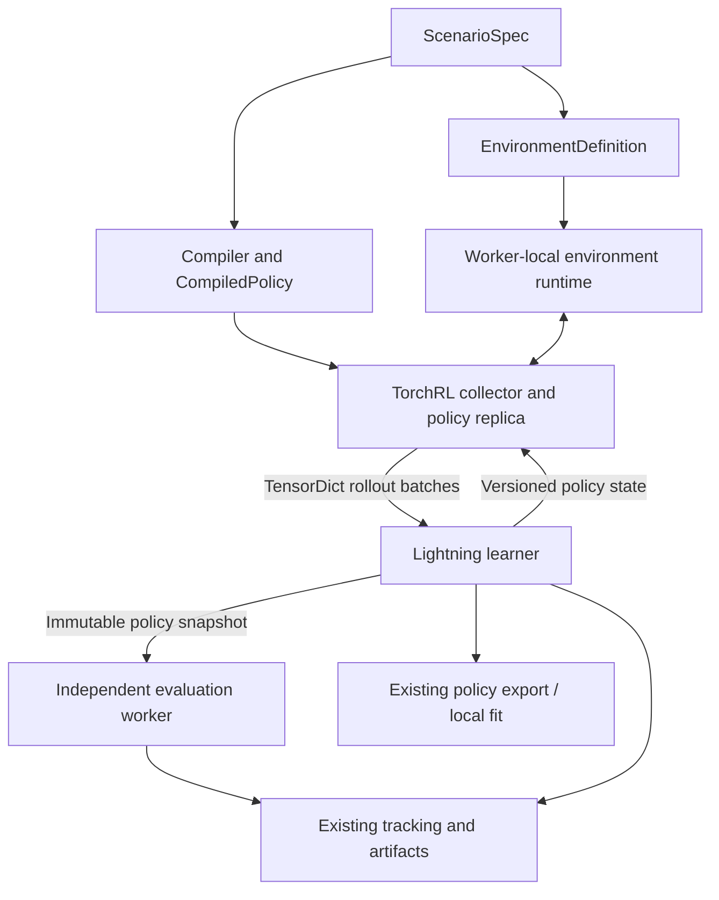
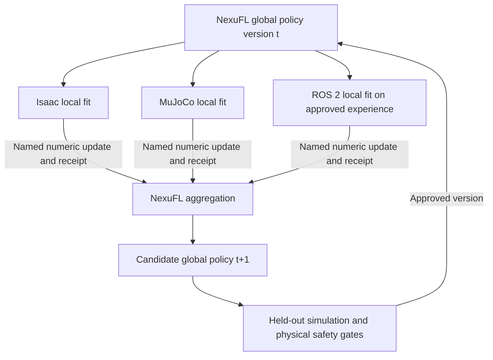

# Design

## Context and baseline

Reviewed branch `feature/nex-212-add-reinforcement-learning` at `c745927b505b1ca2402186217949c7d454e8ee45` (NEX-248 SO-101 Arena evaluation on Ray). Review implementation against the actual current head before editing.

| Existing seam | Baseline behavior |
| --- | --- |
| `src/nexuml/core/components.py`, `core/types.py` | Serializable EnvironmentDefinition, describe/build/job_scope, InteractionContract, CollectorSpec |
| `core/compiler.py`, `core/policy.py` | Simulator-independent compiled policy and explicit action semantics |
| `reinforcement/torchrl_env.py` | Framework-neutral runtime to TorchRL EnvBase, TensorDict transitions, grouped agents |
| `reinforcement/collector.py`, `ray_collector.py` | TorchRL collector; Ray is synchronous CPU-only, address=local, num_gpus=0, version-specific shutdown repair |
| `training/reinforcement.py` | Lightning manual optimization, iterable rollout source, weight sync, frame-based evaluation |
| `library/.../environments/isaaclab.py` | Direct synchronous single CUDA device, one learner, no automatic fit evaluation |
| `library/.../environments/_isaaclab_runtime.py` | Native Kit/process ownership and simulator bindings; already handles sensors/MARL/terminal semantics |
| `library/.../evaluation/arena.py`, `arena_so101.py` | Benchmark-only environment definition, separate native lifecycle, fixed held-out conditions |
| `evaluation/policy.py` | Generic single-env replay vs upstream benchmark; strict physical identity and description equality |
| `execution/ray.py`, `ray_job.py` | Ray Train learner placement vs whole-job remote submission; neither is GPU rollout distribution |

## Goals / non-goals

Product direction: use native robotics tools for initial training where they suffice; earn NexuML's role as a shared local learning and portable policy lifecycle across Isaac, MuJoCo and physical ROS 2 clients consumed by NexuFL. The goal is one compatible global actor (or explicitly selected shared parameter subset), not one physics engine, one task recipe or one optimizer across all clients.

Goals: one public scenario/CLI/SDK workflow; exchange native environments without rewriting learner code; independently place simulation, inference, training and evaluation; preserve physical correctness and GPU-native paths; clean provider boundaries; preserve reproducible export and existing supervised/local-fit functionality.

Non-goals: universal scene DSL, generic robot/sensor/physics reimplementation, simulator fleet service, custom transport, RLlib/second trainer, asynchronous PPO, general model parallelism, universal checkpoint portability, real-robot online exploration, all simulators or all benchmarks in one release. No sibling repository, cluster configuration, licensing or credential changes. No new compatibility lanes without evidence and approval.

## Decisions

### 0. Native-first decision gate before broad refactoring

Compare native Isaac Lab training with NexuML on the **same reward-bearing SO-101 task** (joint reach is acceptable for the first gate; it is not manipulation). Use an upstream-maintained learner supported by the pinned stack, e.g. RSL-RL or skrl PPO; also use a minimal native TorchRL path when supported to isolate adapter/orchestration overhead from algorithm differences. Do not manufacture identical numerical results from different PPO implementations.

Freeze native task/factory, asset/physics revision, observation/action/control semantics, rewards, terminations, vector width, device, frame budget, seeds, network sizes, initialization, optimizer/hyperparameters and evaluation protocol where possible. Record any unavoidable differences (normalization, GAE, clipping, minibatches, schedules, number of updates). Use same qualified hardware/image and disable or match logging/rendering during timing. Record warm-up/startup separately, at least three matched seeds for learning comparisons, and repeated warm timing measurements. Report mean/spread, curves and failures; predeclare tolerances and success criteria before running, not after inspecting the results.

| Question | Evidence |
| --- | --- |
| Does NexuML preserve scientific correctness? | Known-action probes, terminal/truncation behavior, update/frame accounting, finite losses, held-out native success/return and time-to-target |
| What overhead does it add? | Wall time, simulation/collection/optimization breakdown, frames/s, GPU utilization, peak VRAM/RAM, initialization/export cost; separate algorithm vs adapter effects |
| Does the SDK simplify multi-provider work? | Minimal comparable runnable examples, provider-specific glue/LOC and dependency count, configuration and maintenance burden, documented custom-task changes |
| Does it enable NexuFL? | Clean export/reload inference parity; two bounded local fits using different externally supplied initial actor tensors, validated numeric update receipts and compatibility/provenance separation |
| Can native users adopt without replacing training? | One explicitly supported native actor checkpoint mapped using trusted local code into the shared NexuML actor contract; known-input parity including normalization and action mapping, native held-out evaluation, bounded fine-tuning |

Record results and an explicit maintainer decision: retain the existing adapter where justified, replace redundant code with qualified upstream components, or narrow NexuML to a thinner integration/local-fit layer if native performance/maintenance or interoperability is unacceptable. Keep native direct training available for baselines. Gate expensive simulator breadth and distributed optimization on this evidence; no need to reproduce every native feature or algorithm. A failed or blocked comparison does not silently pass. Native-first import initially covers one named architecture/format, not arbitrary third-party weights, executable checkpoint code, policy semantics or optimizer continuation. Deployment/inference-only import is not evidence of trainable compatibility.

### 1. Keep three independent axes and existing APIs

EnvironmentDefinition describes native task and contract; collection selects direct/process/Ray and resources; learner uses canonical NexuSession/Lightning (Ray Train remains a separate learner placement choice). Evaluation has its own placement. Ray Jobs submits a job, not a collection backend. Use existing registry, serialization and type/version/params conventions; do not introduce parallel configuration or a new public trainer. Compile/validate on a simulator-free coordinator. Build live resources only where placed.



Use the existing runtime adapter unless a maintained TorchRL wrapper demonstrably preserves physical contracts, native batches, final observations, partial reset and MARL behavior. Do not duplicate EnvBase, replay, GAE, loss or collector implementations for each simulator. Prefer maintained collector/transport primitives and keep any version-specific shim narrow and tested.

### 1a. Foundation handoff for system integration

The follow-up `integrate-robotics-stack-and-teleoperation` consumes the existing EnvironmentDefinition/Runtime, InteractionContract, InteractionStep, EnvironmentBuildContext, ActionAdapterDefinition and CompiledPolicy. Extend these only as demonstrated; no second environment hierarchy, universal middleware, event bus, speculative skill framework or custom teleoperation protocol.

- Purpose/lifecycle: train, evaluate and play now; an explicit extensible purpose/capability boundary for teleoperate, record and authorized deploy. One owner builds, observes, executes, resets when supported and closes the runtime. Recording is composable, not a competing owner. Physical hardware cannot be assumed to offer reset, pause, accelerated time or vectorization.
- Action-source independence: the environment executes contracted actions and reports feedback regardless of policy, human, scripted expert or external controller. Reuse action mapping/validation; prove scripted and learned actions use the same runtime. Preserve requested/executed action and source identity without implementing arbitration, human takeover or remote input here.
- Provider capabilities: minimal declaration or existing validation methods for vector width, reset/partial reset, clock/pacing, viewers, purposes and command semantics. Reject incompatible operations before allocation where statically possible, confirm native readiness at build. No provider-name branching or hypothetical feature registry.
- Timing: preserve available sensor acquisition time, clock domain, frame, rate, freshness/validity and action issue/application time; distinguish fixed-step RL transitions from asynchronous bounded goals with duration, completion/failure/cancel. No fabricated timestamps or forcing asynchronous navigation into fixed PPO steps; actual skill executor belongs to follow-up.
- Inference-only handoff: prove installed complete policy export (processors, normalization, adapter, temporal state/reset) on recorded observations without Lightning, collectors, Ray, simulator, ROS or NexuFL dependencies where model-specific inference dependencies permit. Reuse same artifact for playback and compatible deployment, and its approved trainable state for local fit.

Acceptance is a small direct proof plus installed inference artifact test. Follow-up need not wait for all Ray scaling, optional simulators or physical gates. It owns full-stack ROS/Unitree, teleoperation, mobile manipulation, selected ten Isaac reference deliveries and physical G1 readiness; reuse foundation and existing umbrella evidence. No duplicate implementation queues.

### 2. Native task composition, not a universal simulator

A native robotics project remains independently usable without NexuML. Reuse the existing registered task and typed customization mechanisms (native-isaac-task-configuration NC1–NC5). Keep the original Isaac Python configuration, robot/USD assets, actuator and sensor definitions, manager terms or custom DirectRLEnv implementation, and native registration in the project-owned package. Only the learning scenario, explicit portable interaction contract and bindings are NexuML-specific. Existing RSL-RL/skrl configs and native train/play scripts may stay alongside the NexuML scenario; they are not translated into a second environment schema. Qualify the same installed native configuration/task in a native runner and ordinary NexuML train/play, including a project-owned custom direct workflow (not just a renamed manager task). Native version migration, real terminal/reset support and compatible sensors/actions are prerequisites, not automatic compatibility promises. Use importable trusted modules/factories rather than a standalone training script that launches its own app. Arena compositions follow the same rule; use their actual native scene/embodiment/task builder and keep composition code native-runnable.

Isaac Lab and Arena are not competing physics engines. Arena composes scene, embodiment, task, rewards, success and variations using its native builder; its output is a native Isaac environment. Support an importable trusted factory/definition (working name IsaacArenaEnvironment) for ordinary training, replay and recording. Reuse the existing IsaacTaskConfigSpec, FactorySpec, IsaacBindings and contract declarations where they fit. Share runtime mapping and lifecycle with the existing IsaacLabEnvironment; keep explicit native construction choices and version-dependent builder options. Do not make Arena mandatory for plain Isaac.

Retain the benchmark runner (working name ArenaBenchmark; existing ArenaBenchmarkEnvironment may remain an implementation detail if simpler). Use maintained suite runner, seeds, native episode recorder, metrics, condition identities and failure reports. Do not silently substitute generic PPO replay for benchmark evaluation. Avoid duplicate startup and native task-specific branches. Prefer moving SO-101-specific configuration into native reference task modules rather than growing the generic runtime.

Kit/app context belongs to its owning process. Direct mode retains a well-defined local process scope spanning needed finalization. In distributed mode, a worker enters/owns the native scope before importing/constructing the simulator, retains it for the collector lifetime, then closes resources in the correct order; the learner does not launch Kit. Confirm signal handling and upstream fast shutdown semantics; if necessary isolate Kit in a dedicated worker process rather than relying on unsupported in-actor teardown. Do not nest conflicting Kit scopes or promise hot switching of providers within one process.

### 3. Distinguish compatibility from identity

Keep the existing physical contracts and explicit observation/action mappings. Policy compatibility is semantic: names, shapes excluding runtime batch width, dtype, units, frame, axes, joint ordering, calibration/embodiment semantics, normalization, bounds, control mode/rate, temporal/reset behavior and actor-visible groups. Critic-only observations are training-specific but must be available for the selected algorithm. Provider labels, asset hashes and prose descriptions alone do not establish or disprove compatibility; preserve them as provenance. If timing, embodiment, control or sensor semantics differ, require an explicitly versioned, validated adapter or reject; no shape-only coercion. Existing safety/deployment restrictions remain intact.

Keep exact checkpoint continuation stricter: native task/physics/assets, model and algorithm identity, compatible optimizer and rollout geometry, state and counters. Supported resume creates a fresh simulator; no claim of exact physical trajectory restoration. Record changed topology and reject unsupported continuation. Do not weaken SO-101 local-fit/dataset integrity or previously qualified export behavior.

### 3a. NexuML as the local learning backend for NexuFL

The shared unit is a **versioned global actor and its agreed semantic contract**, not a complete trainer checkpoint or an independently trained model. Each federation client is an operator-owned local learning program. A client may use local Isaac, MuJoCo, offline ROS 2 trajectories or an explicitly authorized physical interaction runtime; it may use its own local simulation workers via Ray. A Ray rollout worker within one learner is not a federated client. No raw trajectories cross the federated boundary by default.



**Reuse the NEX-234 local-fit boundary.** The current `src/nexuml/training/local_fit.py` and `local_fit_manifest` accept only bounded dataset-training recipes with exact local binding and full numeric state, and hash training/loader/interaction details into recipe identity. Keep that published/qualified behavior. Extend the same public SDK by a minimal versioned contract or supported mode for RL and multiple local recipes; do not weaken existing manifests or create a second learner. Trusted recipes, assets and datasets remain installed/operator-bound; the remote request supplies approved numeric weights, expected shared manifest/base version and authorized bounded budget, never executable code. Reject unauthorized data/transport and unsupported modes before allocation.

Distinguish three identities in the new contract:

| Identity | Scope |
| --- | --- |
| Shared model/aggregation manifest | Architecture/parameter schema and exact named tensor roles/shapes/dtypes, approved trainable subset, actor input/output physical semantics, normalization/processor and action mapping state policy, schema version |
| Base policy identity | Exact initial shared tensor content digest and global version supplied to every client in a round; independent of runtime/recipe |
| Local recipe and provenance | Locally trusted code/config hash, native asset/physics/ROS calibration, task/reward/objective, data or environment binding, algorithm, seeds, effective budget, runtime and optimizer/critic ownership |

Client-specific recipe hashes may differ while the shared manifest and base match. Shared actor tensors must have the same architecture/parameter correspondence and semantic interface (or an explicitly validated local mapping); no averaging unrelated independently initialized models, different action heads or merely equal-shaped weights. Explicitly define shared vs frozen vs client-private state. Keep critics, target networks, optimizer state, replay buffers, raw observations/trajectories and robot handles local by default; do not average running normalization statistics or non-floating buffers blindly. Shared preprocessing/buffers must be immutable or use an explicit approved aggregation rule. If needed, distinct local heads/adapters and a common trainable backbone are a separately qualified shared-subset configuration, not arbitrary heterogeneous model aggregation.

Start from one versioned policy and use bounded synchronous local fitting. For RL, gather fresh on-policy experience after loading the supplied base, with consistent local actor versions per PPO update. Initially reset optimizer and initialize/reset or explicitly define local critic state per fit; persistent local state is opt-in only with versioned ownership and tests. Offline ROS 2 demonstrations may use behavior cloning or a qualified offline method; logged transitions cannot be treated as fresh on-policy PPO data. Physical online adaptation requires explicit operator authorization and qualified safe control envelope, watchdog, emergency stop, supervision, bounded actions, no unapproved exploration/reset and local abort on unsafe observations. No automatic physical deployment of aggregated weights.

Return finite, validated named numeric state in the existing full-update convention first (or explicitly versioned delta where the consumer supports it), plus base/manifest identity, trainable scope, local objective and provenance hashes, actual transition/window/episode and optimizer-step counts, approved bounded metrics and status. Never equate optimizer steps, padded samples, simulator transitions and real demonstrations as interchangeable aggregation mass. Start the multi-provider proof with the same task and compatible local objective. For the first three-domain proof, use genuine compatible Isaac, MuJoCo and approved real ROS 2 demonstration episodes with a common behavior-cloning target/loss, the same actor and declared local budgets; use the existing dataset local-fit mode where possible. Interactive simulation PPO is a separately qualified bounded local-fit mode. Compare equal-client and equal-domain reference weighting (for domain d, weight each of its n_d participating clients by 1/(D*n_d), where D is the number of represented domains); also document any justified count- or quality-weighted alternatives. These are experiment configurations for the NexuFL consumer, not a new NexuML aggregation algorithm or a guarantee of fairness. Large simulator frame counts must not silently overwhelm scarce real-world observations.

After common-objective qualification, run an explicit mixed-objective feasibility experiment: start all clients from the exact same global actor, allow Isaac and MuJoCo clients to perform bounded fresh-rollout PPO, and let the real ROS 2 client learn from authorized demonstrations or a separately qualified offline objective. Align the shared actor parameter roles, observation/action processing and control semantics (including any stochastic policy heads); if an objective cannot train the same declared actor subset, do not aggregate it. Keep critics and optimizer states local, record per-client objective/loss scale, effective budget, count semantics, update norm and direction/conflicts, and compare candidate outcomes against matched common-objective, simulation-only and local-only baselines. Predeclare per-domain success/regression criteria and weighting choices. Report negative or inconclusive outcomes honestly and do not promote incompatible or regressive candidates. Actual end-to-end federation and algorithm selection belong to NexuFL. Heterogeneous dynamics, rewards, data quality and objectives can conflict; interface compatibility alone never guarantees improvement. No automatic raw data or sensitive path/telemetry disclosure; numeric model updates are not a formal privacy guarantee.

NexuML acceptance: a thin local caller/fixture exercises the real existing SDK from one base on Isaac and MuJoCo first (CPU MuJoCo suffices for this gate, GPU qualification remains separate), plus ROS 2 recorded/authorized real experience with the same contract. Prove repeatable external-weight fits, check actual changed shared tensors, reject stale/wrong base, schema or semantics and nonfinite/frozen tensor changes; combine compatible full updates/deltas via a small deterministic **test-only** reference average, reload the candidate into each compatible evaluator and execute a second bounded round from it. Report per-domain held-out performance, global vs local-only and simulation-only baselines, client update norms/conflicts and worst-domain regressions; no claim of improvement without evidence. Synthetic/fake ROS transport proves only SDK wiring; real recorded or supervised physical trials need separate evidence and operator-approved hardware. A simulated client is not a physical client. Do not block the initial simulator-only handoff on acquiring hardware; keep the real three-domain gate blocked/unverified until evidence exists. Conversely, once authorized compatible physical episodes exist, run the three-domain and mixed-objective feasibility gates independently of Ray scaling, GPU MuJoCo, Gazebo/CARLA and other unrelated simulator expansion.

NexuFL owns federation membership, transport, privacy/security policies, aggregation algorithms and weighting, stale/duplicate update rejection across clients, global versioning, evaluation/promotion/rollback and deployment. NexuML owns local validation, fitting, numeric receipts, policy export and evaluation; the fixture verifies the interface, not a new production aggregation implementation. Hand off the versioned manifest/result schema and pinned package to NexuFL, with explicit follow-up to qualify real multi-client rounds and promotion safeguards. No NexuFL imports, gRPC, separate federation trainer or sibling-repository edits here.

### 4. GPU-native learning is primary; placement is independently selectable

Decoupling means placement is configurable, not mandatory separation. Retain the canonical NexuRLLightningModule, TorchRL objectives/collectors, CompiledPolicy and native vectorized environments. Do not replace TorchRL with RSL-RL, create a second training loop or invent collective transport.

1. **Direct same GPU (default):** native simulator, actor/critic inference, rollout storage, GAE and optimization remain on one logical CUDA device; no Ray requirement, forced CPU staging, per-step RPC or extra vectorizer. Preserve selected sensor renderer even when spectator is disabled.
2. **Co-located data-parallel PPO (primary distributed strategy):** one process/rank per allocated GPU, each owns one native simulator, native parallel environments, actor/critic, local CUDA buffer and learner. Use existing Lightning DDP and existing Ray Train/RayDDPStrategy or standard local multi-GPU launch, not Ray Jobs as a gradient backend. PyTorch selects NCCL for supported CUDA execution; prove actual backend and collective health. Reuse existing execution registration and resource schema; adapt RL frame-budget lifecycle rather than supervised max_epochs assumptions. Ray Train places ranks; Ray Jobs submits whole experiments; TorchRL Ray collectors remain distinct. All ranks initialize identical model/optimizer state and independent nonoverlapping seeds; assign worker-visible GPU, verify physical GPU UUID and actual rank/node placement. Never serialize live native objects. Keep observation/action/rollout hot path on CUDA per rank and synchronize trainable gradients through supported DDP hooks, not full rollout tensors. Verify manual PPO optimization, actor and critic reducers/unused parameter handling, equal minibatch/update counts per rank, explicit globally defined total_frames/frames_per_batch and divisibility (per-rank width and time), actual global transition/optimizer counters, correctly weighted losses/metrics and declared global or rank-local advantage normalization with mathematical parity. No double-counting rank samples; no hidden all-gather of trajectories; equal budgets/checkpoint state, rank-zero artifact/log ownership, synchronized resume from fresh native ranks and bounded failure/cancel on collective/rank loss. Begin single-agent PPO, reject unqualified MARL/asynchronous/FSDP variants until separately proven. Use actual two-process CPU/Gloo tests as software correctness evidence, then CUDA NCCL preflight, two GPUs same-host when available and two distinct GPU nodes (including one-GPU-per-pod). No local/private cluster fallback.
3. **Same-host separate GPUs (optional):** simulator/inference and learner devices differ when memory or profiling warrants. Prefer supported device-to-device transfer (prove P2P availability rather than assume it); explicit supported host staging only at batch boundaries if necessary. Keep inference/learning GPU-native. Do not force same GPU in provider validation for a qualified split; fail closed on unsupported placements. Use persistent copied inference state where needed, synchronize at each on-policy update. Support synchronous split first; do not introduce stale asynchronous PPO to overlap collection. For algorithms with qualified replay semantics, overlap may be separately supported.
4. **Ray collection (optional):** persistent actors own native vectorized simulator and inference replica on assigned GPU when they fit. Independent GPU learner is allowed with GPU workers, not restricted to CPU. Allocate complete topology (learner + collectors + optional evaluator) with maintained native resources/placement reservation or bounded preflight and admission; no nested indefinite GPU wait. Explicit CPU/GPU/memory requests, resource/label selectors, worker-visible device mappings, prepared worker environments and exact role receipts. Transfer complete versioned TensorDict rollout batches and weights only at batch/update boundaries through maintained mechanisms; CPU object-store staging is explicit and measured for this optional topology, not a universal requirement. No per-step remote simulation RPC by default, no implicit private Ray cluster when targeting existing cluster, no stop of borrowed runtime. Keep existing CPU references, but never silently move a requested CUDA model or learner to CPU.
5. **Large model policy placement:** distinguish simulation/renderer memory, inference weights/activations/temporal cache, rollout tensors (including images), trainable weights/gradients/optimizer/activation memory. DDP duplicates full model on ranks; a separate learner frees training state from collector but still requires inference replica to fit with simulator. If that does not fit, prefer separate inference GPU on same host with batched observation/action transfer and measured control latency; if inference model itself exceeds one device, require a qualified model-specific sharding/inference strategy. Reuse existing supported PyTorch/Lightning FSDP/DeepSpeed/PEFT/mixed precision only where exact model/objective, inference and checkpoint/local-fit semantics are supported; no promise of arbitrary VLA PPO or universal model parallelism. Keep offline IL/VLA fine-tuning on independent learner(s) without simulation; separate evaluation. Frozen encoders or adapter-only updates may reduce memory/weight traffic only when algorithmically valid and exact base/processor/parameter roles preserved. Never implicitly offload to CPU, drop observations, alter precision or swap architecture to make a run fit. For flow/diffusion/token policies require actual compatible action distribution/log-probability/objective, not Gaussian PPO by assumption. A small visual model and configurable synthetic memory-pressure probe can qualify seams; real licensed large VLA qualification remains a resource-gated follow-up and is not required for native state PPO.

Synchronous PPO/IPPO/MAPPO maintains complete version-consistent rollout and update barriers, native time/env axes, true final vs reset observations, terminated/truncated, behavior statistics, masks and actual physical transition counts. For remote collectors require updated weight acknowledgment before next rollout; for DDP require consistent per-rank update and parameter state. No partial optimizer update on stale/incomplete data; fail coherently and resume only from committed checkpoint. For distributed learners rank-local local-fit results are not separate FL clients: one global logical local-fit update/receipt per job, exported shared actor identity and private optimizer/critic state; qualify or reject this topology for local_fit until correct. Measure actual batch bytes, policy/gradient communication, collect/GAE/optimization/transfer/sync times, allocator and device-wide peaks, startup/shutdown and scaling efficiency. Compare equal global frame budgets and held-out task outcomes; also report weak-scaling separately. Use same task, hardware class, seeds, native backend, declared algorithms/precision and workload; benchmark 256/1,024/4,096 envs where memory supports, record measured smaller viable counts instead of OOM loops. Profile before optimizing necessary TensorDict copies, validation, synchronization or logging; preserve correctness. 90% of matched native RSL-RL warm throughput is an optimization target, not a guaranteed gate or permission to replace TorchRL. Original 32-env state SO-101 result remains historical; do not claim it predicts VLA throughput.

The initial single-agent lane keeps GAE local to trajectories and reduces
advantage moments across the global PPO minibatch. Minibatch size and frame
budgets are global; simulator width is per rank. Ray Train V2 runs on a
background training thread and can use a qualified Kit-less Isaac profile.
Use main-thread torchrun for full Kit; no upstream signal monkeypatch.

Upstream guidance: [Isaac Lab multi-GPU training](https://isaac-sim.github.io/IsaacLab/main/source/features/multi_gpu.html), [TorchRL IsaacLab integration](https://docs.pytorch.org/rl/main/reference/isaaclab.html), [PyTorch DDP](https://docs.pytorch.org/docs/stable/generated/torch.nn.parallel.DistributedDataParallel.html), [Ray Train Lightning](https://docs.ray.io/en/latest/train/getting-started-pytorch-lightning.html). Probe pinned APIs, especially TorchRL wrapper/reset and graceful shutdown. Avoid broad dependency upgrades/private overrides without targeted evidence.

### 5. Independent evaluation

Use existing policy evaluation selection and execution/registry surfaces, not a benchmark server. Remove the blanket native Isaac fit-evaluation rejection only for a qualified independent process or Ray evaluator with its own native scope and explicitly reserved GPU; reject unsupported shared/in-process app combinations. In distributed learner mode exactly one designated rank snapshots/publishes; coordinate blocking/final completion across ranks without deadlock, with source global frame and explicit skip/failure policy. A slow evaluator or viewer must not silently mutate or terminate an otherwise valid ongoing fit; required final evaluation failures remain explicit. Snapshot the complete deployable actor, processor/normalizer state, action adapter, manifest and policy version at a consistent update boundary. Evaluate from an immutable snapshot on a fresh process/actor with its own resources, seeds and task lifecycle; no learner optimizer or simulator ownership. Evaluation may be blocking by explicit selection or scheduled asynchronously with a bounded queue (initially one in-flight snapshot; coalesce periodic requests with recorded skips, never silently drop required final evaluation). Track source update/frame and artifact digest, not current learner counters. Required final evaluation completes before successful run finalization; failures/cancellation are visible and scoped to the run. Reuse tracking and artifact publication, and retain standalone CLI evaluation of checkpoints and packages. Keep video bounded; native suite recording retains suite semantics.

### 5a. Interactive policy playback is separate from scientific evaluation

Isaac Lab play.py/isaaclab play is the UX reference, not a separate framework. Add an ordinary public `nexuml play POLICY` and equivalent Python entrypoint using the complete loaded deployable policy, existing scenario/contract resolution, inference adapter, native environment and execution scope. Share the rollout primitives with generic episodic evaluation (extract only what is necessary); do not duplicate a simulator or inference loop per CLI command. Arena suite evaluation remains an independent benchmark path. A benchmark-only definition is not an ordinary playable environment; require a compatible runnable native task/composition explicitly. Accept exported policies and supported trusted trainer-checkpoint inputs via the existing loading path without constructing an optimizer or resuming training. Resolve an optional trusted scenario/environment override and validate compatibility before native allocation.

- **Train:** finite learning budget, headless by default, explicit nonmutating spectator.
- **Evaluate:** finite frozen protocol, headless by default, separate optional nonmutating visualization/recording, no interactive reset/commands or timing changes. Preserve existing deterministic metrics and native Arena protocol.
- **Play:** fixed weights, default continuous until user stop/cancel or native viewer closure when supported; optional finite episode/step/time budget, deterministic or explicitly stochastic seeded inference, explicit environment selection, visualization and simulation-only interactions. Explicit headless playback also works, including bounded unattended CI. Do not silently turn a playback session into scientific evaluation, new training data, deployment or a learner.

Use the existing native batched runtime: `num_envs` is a playback placement/runtime setting, not a model shape or the number of windows. Support N=1 and native vectorization (e.g. 16/64 instances when qualified), actual per-instance termination/truncation, same-step autoreset and masked explicit resets only where required by the provider. Reset policy processor/history, recurrent/chunk state and episode counters for exactly the affected rows, preserving other rows and terminal observations. Do not create one Isaac application per instance or wrap an already-vectorized environment in another vectorizer. Report actual simulation transitions and episodes. Seed per environment reproducibly; never claim identical trajectories after human intervention. Visible environment indices/max visible count are separate from simulated width, must be validated and must not alter policy camera observations or count. Preserve native GPU residency. Optional real-time pacing or speed multiplier uses declared control period/simulation clock and wall-clock throttling, not altered physics dt/decimation, skipped required control updates or training budgets. Headless and fast playback can run unpaced; report if real time cannot be sustained.

Permit native-backed simulation controls only for an explicit play session and only when the provider and selected viewer qualify them: camera/follow and displayed-instance selection, pause/resume, single step, individual/all resets, speed, diagnostic plots (observations/actions/rewards/joint or sensor state), and declared task commands such as target walking velocity/direction. Controls that mutate simulation are separately authorized, validated at the actual dispatch boundary and applied at safe step boundaries; reject unsupported/forged/out-of-range commands, no generic code execution, arbitrary forces, actor-state edits or physical robot actuation. A viewer's display-only pause is not a physics pause. Do not remove existing spectator denials globally; playback controls are an explicitly separate capability/purpose with tests. Record interventions when reporting play results. Use bounded existing GIF/MP4 or qualified native recording/artifact path with actual frame/time identity, independent of viewer selection; no new recorder service. For continuous playback, recording needs a configured bound. Physical ROS 2 remains a distinct authorized inference/monitoring/deployment workflow with existing watchdog/limits/safe-stop; generic simulation play and reset/command controls SHALL NOT implicitly actuate real hardware.

Proposed CLI (exact option names should reuse current conventions; not implemented):

```bash
nexuml play ./policy --viewer local --num-envs 16 --device cuda:0
nexuml play ./policy --viewer viser --num-envs 64 --real-time
nexuml play ./policy --viewer webrtc --num-envs 16
nexuml play ./policy --viewer headless --episodes 10
````

Use existing typed scenario configuration and CLI overrides, and existing execution registry/Ray Jobs submission with worker resource selection; no new playback server/transport. A remote playback job owns its simulator, policy, viewer, output and cancellation independently of training. The client sees run/job identity, actual worker location and viewer connection details; no local GPU, implicit local fallback or remote per-step control loop. A disconnected spectator need not stop a simulation; explicit stop/cancel always cleans owned resources. Provide a callable playback entrypoint suitable for future Studio integration (select policy/environment/device/count/viewer and stop session); building a new Studio UI is not a prerequisite. Generalize the same public interface to qualified MuJoCo, Gazebo and CARLA providers, without assuming they share Isaac visualizers, support vectorization or expose all controls.

### 5b. Four native Isaac viewer modes

Replace the Viser-only selection with one small typed viewer selection using existing config serialization (reuse ViserSpec settings rather than creating a parallel schema). Preserve explicit train/eval opt-in and existing persisted semantics via the repository's current-schema policy; no competing public headless boolean. Omitted viewer means headless for train/evaluate; play uses its explicit scenario/CLI selection, with a documented provider-supported native local default if no viewer is specified. Headless play remains explicit. A saved training viewer does not implicitly activate playback or formal evaluation. Unsupported modes/physics/render combinations fail closed, never silently switch renderer, backend or device. Viewing configuration is execution/display metadata, not the semantic actor contract or exact task identity.

| Viewer | Intended native Isaac mapping (qualify exact pinned launch APIs) | Access / prerequisites |
| --- | --- | --- |
| headless | No interactive visualizer, headless launch, livestream off | No listener or desktop; offscreen camera/sensor/rendering still enabled when required by task or recording |
| viser | Native Viser visualizer in headless runtime, livestream off | Existing loopback-only HTTP/WebSocket, sharing disabled, private TCP forwarding by caller; select visible instances independently |
| webrtc | Native Kit visualizer/livestream with headless application, native streaming client | Supported GPU/encoder (NVENC as required), graphics/runtime, configured reachable native TCP signaling and UDP media endpoints on trusted private network |
| local | Native Kit window, non-headless display, livestream off | Existing local desktop, qualified X11 display or TigerVNC/virtual desktop with required GPU graphics/Vulkan support |

The exact native options and endpoint defaults are version-specific; probe actual pinned Isaac Lab/Sim launcher before setting them. Isaac Sim authoring remains a separate existing full application workflow/image; playback runs a live policy simulation, not a new USD editor. Reuse existing `containers/isaac/` image and CI image workflow plus native application launcher; no second Isaac image solely for viewing, custom renderer, video streamer or desktop manager. Keep optional viewer dependencies lazy; headless state-only jobs must not acquire desktop/streaming requirements. Camera observations and recording do not depend on opening a viewer.

Use the native WebRTC support that was previously exercised with the Isaac Docker application and NVIDIA streaming client over a private NetBird connection; that prior authoring workflow does not by itself qualify NexuML train/play. Configure native supported bind/advertised address/ports explicitly as needed, report actual native endpoints and prerequisites, require trusted private network and operator approval; no automatic public exposure or claim of built-in authentication/encryption. NexuML SHALL NOT install, configure or operate NetBird, VPN routes, SSH tunnels, firewall rules, Kubernetes port forwarding, VNC servers or X11 sessions. Document user/infrastructure-owned connection examples only. Viser continues its existing localhost-only construction and exact requested-port verification, including 8081 on the existing KubeRay profile where 8080 is occupied. A remote local mode uses an already prepared display, never starts TigerVNC itself. Ordinary SSH X11 availability is not proof of Kit Vulkan/accelerated rendering; qualify a real supported display, record other untested display paths as such.

Distributed training defaults to no interactive graphics. A single explicitly selected rank/collector may expose a private native read-only Viser spectator of its actual rollout (not a snapshot simulation); all others remain headless, only a bounded visible subset and unique port, no effect on sensor/control semantics, counters or collectives. Qualify selected-rank failure/disconnect/overhead and do not silently enable viewer everywhere. Independent snapshot play is complementary, not a replacement for live training. Prefer Kit-less native Lab profiles (Newton/OVPhysX/OVRTX as actually supported) where task, physics and offscreen sensors qualify; full Kit remains available for required native rendering, local viewport, authoring and WebRTC. Do not require Kit on every Ray worker. WebRTC play is a separate prepared graphics/encoder/network-capable job or local runtime via existing public execution backends, not an actor-hosted stream prerequisite. Report supported signaling TCP and media UDP endpoint/device/advertised address; TCP port forwarding alone does not establish UDP reachability. Existing authenticated loopback TigerVNC/Xvfb and local Kit receipts remain scoped passes; forwarded Windows X11 and external WebRTC are optional profile gates and do not block headless/Viser or software readiness. Training and benchmark viewing must remain read-only regardless of viewer mode; preserve existing Viser callback/request denial and no mutation of training state/physics/clock/task/seed/budget. If native Kit/WebRTC/local control cannot be made nonmutating through maintained interfaces, reject that viewer for train/evaluate and qualify it for explicit simulation play only; do not weaken scientific guarantees to expose all modes everywhere. Explicit play permits only qualified native-backed controls and does not grant arbitrary Kit editor/task mutation as part of a measured run. Distinguish missing display/encoder/port/graphics prerequisites and unsupported control modes from successful headless execution. No public listener or fallback. On completion, viewer closure (when supported), failure and cancellation, close owned native applications/streams/listeners, threads, and publish required artifacts before fast shutdown; borrowed cluster, network and display infrastructure remain untouched.

### 6. Provider and dependency boundaries

- Isaac Sim/Lab/Arena: existing native task configuration and GPU runtime. Baseline container pins Sim 6.2.0 and Lab 3.0.0 revision 70ab24fec3eabf51222817db0cdb5a4e7133bd7e; benchmark expects Arena 0.4. Verify actual package/source versions and compatibility, not the older Sim 5.1 documentation.
- MuJoCo: retain CPU Gymnasium recipes; qualify upstream native MuJoCo/Warp or Playground GPU reference (choose supported implementation after profiling, interop and dependency probe). Prefer PyTorch interoperability where supported; if JAX is needed, prove conversion/device placement. No claim every solver or camera is equivalent. Use upstream assets/configuration. Demonstrate one matching task/contract across two providers with known-action and policy inference probes; compare outcomes as physics differences, not guaranteed equal returns.
- Gazebo: native ROS 2/SDF worlds, explicit simulation time, step/reset and namespace ownership; use standard simulation interfaces where supported. CARLA: native client-server/world ticks, synchronized sensor timestamps, reset/actor cleanup and exclusive tick authority. ROS 2 hardware: explicit observation/control transport, timing, watchdogs, bounded commands and safe stop; no accelerated/reset assumptions or unsupervised exploration. Preserve existing implementations; these are staged extensions, not a universal task conversion.
- Kubernetes: existing Ray/KubeRay heterogeneous worker groups can advertise resources/labels; use documented Ray-native scheduling. Learner image does not need native simulator dependencies. Maintain the NexuML-owned optional dependency and CI image workflow, including existing Isaac image; use separate image/profile only where incompatibility requires it. Do not model Kubernetes pod topology in core. Keep driver/runtime/asset/license prerequisites explicit and operator controlled. Qualify version tuples (Python, CUDA/driver, PyTorch, TensorDict, TorchRL, Ray, simulator/Arena/Warp), including actual rendered/GPU operation and Ray cross-image serialization.

## Proposed file-level changes

Adapt existing files first; names below are targets, not a demand for empty abstractions or repository-wide moves.

| Area | Target |
| --- | --- |
| Core | `core/components.py`, `core/types.py`, `core/policy.py`, existing interaction contract/runtime modules; semantic compatibility helper reused by evaluation and export |
| Collection | `reinforcement/collector.py`, `ray_collector.py`, `torchrl_env.py`; only extract worker lifecycle helper if needed |
| Learner | `training/reinforcement.py`; preserve Lightning iterable/manual optimization and checkpoint owner; extend `training/local_fit.py` and manifest minimally with a versioned shared actor/local recipe boundary, preserve existing dataset local-fit |
| Evaluation/playback | `evaluation/policy.py`; extract minimal reusable inference rollout primitives and add a small play entrypoint through existing CLI/SDK/registry; small Ray execution adapter only if existing execution dispatch cannot express it |
| Isaac library | group existing `environments/isaaclab.py`, `_isaaclab_runtime.py`, `isaaclab_config.py` and bindings helpers into `environments/isaac/` only if it reduces coupling; add Arena environment composition next to these; preserve public discovery/imports as appropriate |
| Arena | `evaluation/arena.py`, `arena_so101.py`; share native startup and bindings, keep benchmark-specific code |
| MuJoCo and later providers | `environments/gymnasium.py`, optional `environments/mujoco/`, existing `carla.py`, `ros2/`, focused Gazebo integration |
| Config and docs | existing execution/profile/resource definitions, root/library manifests/lock, `containers/isaac/`, CI publishing, scenario and backend how-to docs |

### Illustrative configuration (not a second schema)

Use typed components and the existing canonical serialization for environment/algorithm definitions. Extend CollectorSpec minimally; reuse existing resource/profile types where applicable. Exact field names are implementation decisions. Example fragment:

```yaml
training:
  mode: reinforcement
  accelerator: gpu
  devices: 1
  frames_per_batch: 16384
  collector:
    backend: ray
    num_collectors: 2
    num_envs_per_collector: 256
    env_device: cuda
    policy_device: cuda
    storing_device: cpu
    sync: true
    policy_sync_interval_batches: 1
    # Proposed placement; reuse existing resource schema:
    resources:
      num_gpus: 1
      num_cpus: 4
      # Select a cluster-provided Isaac resource/label.
```

The cluster target and evaluator placement must be explicit through the existing execution configuration or a minimal typed extension. Do not hardcode cluster names, addresses, GPU counts or container paths. Same scenario can select direct collection with one collector and local CUDA storage; training model/algorithm definitions stay unchanged. Validate placement/resource compatibility before starting the native app.

## Related changes, ownership and precedence

- `integrate-robotics-stack-and-teleoperation`: consumes §1a foundation; owns full-stack launch, native ROS/Unitree DDS, teleoperation/recording, higher-level skills, perception and selected robot catalogue. Existing §6 minimal simulator/ROS contract and three-domain local-fit evidence remain here; follow-up supplies robot-specific runtime/data evidence. No dependency on completion of all Ray scaling.

- `add-reinforcement-learning`: owns the original canonical learner and portable runtime; this follow-up qualifies its existing independent placement intent.
- `add-isaaclab-gpu-robotics`: preserves qualified direct paths, native reset/GAE and historical evidence. Its single-GPU/direct-only and fresh-process replay qualification limits apply to the historical profile; this follow-up supersedes those limits only for newly qualified placements, not by deleting safety checks globally.
- `generalize-isaac-native-configuration-and-marl`: preserve native factory, multimodal, MARL and Viser read-only requirements (NC1–NC6, V1–V5). Worker-local scope extends, not replaces, native lifecycle guarantees. New viewer selection extends the existing Viser configuration; V1–V5 remain authoritative for training and evaluation spectators. Simulation mutation is permitted only in the separate qualified play purpose, not a bypass of the read-only viewer. Reconcile the old schema and historical livestream restrictions before archival.
- `add-isaac-physical-ai-backend`: remains umbrella for VLA, world models, offline learning, ROS, deployment and MuJoCo Playground evidence. Its NEX-234 `local-learning-handoff` and `federation-handoff.md` own the original dataset-only local-fit contract; preserve that contract and extend it through a versioned shared actor/recipe split. NexuFL's separate NEX-235 consumer owns actual federated rounds. This change owns the new distribution/arena-training/cross-provider seams, reuses existing native reference requirements, and does not close umbrella tasks.
- `add-mujoco-reference-workflows`: preserve CPU/Gymnasium and Meta-World evidence, coordinate GPU dependency compatibility with the umbrella's explicit compatibility lanes.
- `qualify-physical-ai-workflows-via-ray-jobs`: retains existing CLI, visual, suite and job acceptance. Its NEX-248 benchmark qualification is a baseline, not proof of GPU distributed rollouts. Its existing acceptance-pool policy remains authoritative for that change; independent collector/learner resource topology needs explicit operator-provided capacity. Use its evidence/report conventions rather than duplicate tests.
- Published Ray training and execution specs remain authoritative for learner placement. Do not duplicate Ray Train or Ray Jobs behavior.

No other change's files or completion history are modified by this proposal. When integrating/archiving, reconcile overlapping unarchived requirements (especially direct-only device restrictions, process scope and evaluation restrictions) into the authoritative specs, preserving old qualified behavior and scope; do not archive conflicting requirements or declare old gates completed on the basis of this proposal.

## Independent implementation and acceptance

See [execution-plan.md](execution-plan.md). Implement all feasible source/config/tests/docs and run permitted bounded local/remote tests without pausing for external GPU placements, network/display/client, binary-only worker artifacts or real data. Keep evidence-based native acceptance separate. Do not mark an unexecuted or blocked gate complete, provision infrastructure or seek repeated permission. The software handoff to robotics integration and NexuFL can be ready on qualified interfaces while optional placements, real-world and remote viewer receipts remain outstanding. Preserve old checked tasks and append scoped requalification when changed behavior demands it. Reconcile acceptance before claiming a supported profile or archival; no global 44/44 prerequisite to proceed with independent development.

## Risks and mitigations

Native dependency/ABI mismatch: pin and probe actual target image and APIs before implementation. Kit process lifetime: qualify graceful shutdown, cancel and failure with no leaked actors/resources. Ray nested allocation/placement deadlock: verify whole topology capacity, including learner + collector + optional evaluator, before scheduling; use explicit reservation or fail with actionable diagnostics. Network bottleneck: batch transfer, versioned weights and measured bytes; do not promise multi-node speedup. Cross-simulator semantics: known-action physical probes and strict mappings, independent provenance. Scientific reproducibility: same frozen scenarios, seeds, learning metrics and separate smoke/quality acceptance.

## References

- https://isaac-sim.github.io/IsaacLab-Arena/main/index.html
- https://isaac-sim.github.io/IsaacLab/main/index.html
- https://docs.isaacsim.omniverse.nvidia.com/5.1.0/index.html (historical; not the pinned runtime)
- https://mujoco.readthedocs.io/en/stable/overview.html
- https://docs.pytorch.org/rl/main/
- https://docs.ray.io/en/latest/
- https://docs.ros.org/ and https://gazebosim.org/docs/
- https://carla.readthedocs.io/en/latest/

Treat rolling documentation as guidance; verify APIs against installed/pinned source before selecting integration paths.
