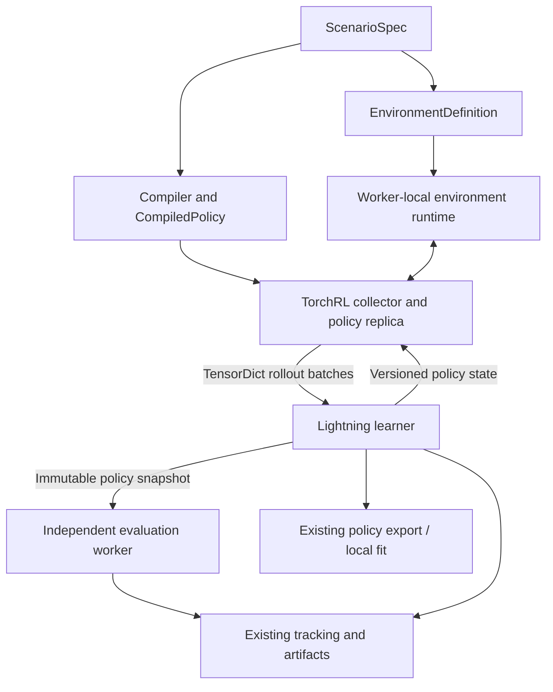
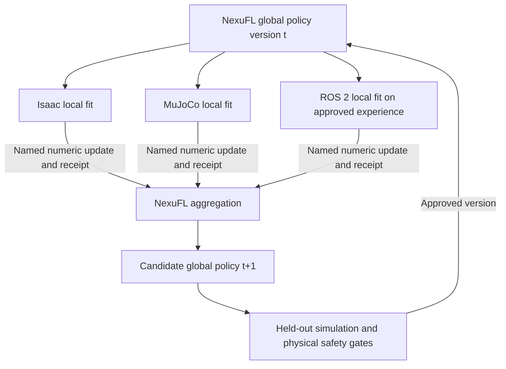

# Design

## Context and baseline

Reviewed branch `feature/nex-212-add-reinforcement-learning` at `c745927b505b1ca2402186217949c7d454e8ee45` (NEX-248 SO-101 Arena evaluation on Ray). Review implementation against the actual current head before editing.

| Existing seam | Baseline behavior |
| --- | --- |
| `src/nexuml/core/components.py`, `core/types.py` | Serializable EnvironmentDefinition, describe/build/job_scope, InteractionContract, CollectorSpec |
| `core/compiler.py`, `core/policy.py` | Simulator-independent compiled policy and explicit action semantics |
| `reinforcement/torchrl_env.py` | Framework-neutral runtime to TorchRL EnvBase, TensorDict transitions, grouped agents |
| `reinforcement/collector.py`, `ray_collector.py` | TorchRL collector; Ray is synchronous CPU-only, address=local, num_gpus=0, version-specific shutdown repair |
| `training/reinforcement.py` | Lightning manual optimization, iterable rollout source, weight sync, frame-based evaluation |
| `library/.../environments/isaaclab.py` | Direct synchronous single CUDA device, one learner, no automatic fit evaluation |
| `library/.../environments/_isaaclab_runtime.py` | Native Kit/process ownership and simulator bindings; already handles sensors/MARL/terminal semantics |
| `library/.../evaluation/arena.py`, `arena_so101.py` | Benchmark-only environment definition, separate native lifecycle, fixed held-out conditions |
| `evaluation/policy.py` | Generic single-env replay vs upstream benchmark; strict physical identity and description equality |
| `execution/ray.py`, `ray_job.py` | Ray Train learner placement vs whole-job remote submission; neither is GPU rollout distribution |

## Goals / non-goals

Product direction: use native robotics tools for initial training where they suffice; earn NexuML's role as a shared local learning and portable policy lifecycle across Isaac, MuJoCo and physical ROS 2 clients consumed by NexuFL. The goal is one compatible global actor (or explicitly selected shared parameter subset), not one physics engine, one task recipe or one optimizer across all clients.

Goals: one public scenario/CLI/SDK workflow; exchange native environments without rewriting learner code; independently place simulation, inference, training and evaluation; preserve physical correctness and GPU-native paths; clean provider boundaries; preserve reproducible export and existing supervised/local-fit functionality.

Non-goals: universal scene DSL, generic robot/sensor/physics reimplementation, simulator fleet service, custom transport, RLlib/second trainer, immediate asynchronous PPO or DDP RL, universal checkpoint portability, real-robot online exploration, all simulators or all benchmarks in one release. No sibling repository, cluster configuration, licensing or credential changes. No new compatibility lanes without evidence and approval.

## Decisions

### 0. Native-first decision gate before broad refactoring

Compare native Isaac Lab training with NexuML on the **same reward-bearing SO-101 task** (joint reach is acceptable for the first gate; it is not manipulation). Use an upstream-maintained learner supported by the pinned stack, e.g. RSL-RL or skrl PPO; also use a minimal native TorchRL path when supported to isolate adapter/orchestration overhead from algorithm differences. Do not manufacture identical numerical results from different PPO implementations.

Freeze native task/factory, asset/physics revision, observation/action/control semantics, rewards, terminations, vector width, device, frame budget, seeds, network sizes, initialization, optimizer/hyperparameters and evaluation protocol where possible. Record any unavoidable differences (normalization, GAE, clipping, minibatches, schedules, number of updates). Use same qualified hardware/image and disable or match logging/rendering during timing. Record warm-up/startup separately, at least three matched seeds for learning comparisons, and repeated warm timing measurements. Report mean/spread, curves and failures; predeclare tolerances and success criteria before running, not after inspecting the results.

| Question | Evidence |
| --- | --- |
| Does NexuML preserve scientific correctness? | Known-action probes, terminal/truncation behavior, update/frame accounting, finite losses, held-out native success/return and time-to-target |
| What overhead does it add? | Wall time, simulation/collection/optimization breakdown, frames/s, GPU utilization, peak VRAM/RAM, initialization/export cost; separate algorithm vs adapter effects |
| Does the SDK simplify multi-provider work? | Minimal comparable runnable examples, provider-specific glue/LOC and dependency count, configuration and maintenance burden, documented custom-task changes |
| Does it enable NexuFL? | Clean export/reload inference parity; two bounded local fits using different externally supplied initial actor tensors, validated numeric update receipts and compatibility/provenance separation |
| Can native users adopt without replacing training? | One explicitly supported native actor checkpoint mapped using trusted local code into the shared NexuML actor contract; known-input parity including normalization and action mapping, native held-out evaluation, bounded fine-tuning |

Record results and an explicit maintainer decision: retain the existing adapter where justified, replace redundant code with qualified upstream components, or narrow NexuML to a thinner integration/local-fit layer if native performance/maintenance or interoperability is unacceptable. Keep native direct training available for baselines. Gate expensive simulator breadth and distributed optimization on this evidence; no need to reproduce every native feature or algorithm. A failed or blocked comparison does not silently pass. Native-first import initially covers one named architecture/format, not arbitrary third-party weights, executable checkpoint code, policy semantics or optimizer continuation. Deployment/inference-only import is not evidence of trainable compatibility.

### 1. Keep three independent axes and existing APIs

EnvironmentDefinition describes native task and contract; collection selects direct/process/Ray and resources; learner uses canonical NexuSession/Lightning (Ray Train remains a separate learner placement choice). Evaluation has its own placement. Ray Jobs submits a job, not a collection backend. Use existing registry, serialization and type/version/params conventions; do not introduce parallel configuration or a new public trainer. Compile/validate on a simulator-free coordinator. Build live resources only where placed.



Use the existing runtime adapter unless a maintained TorchRL wrapper demonstrably preserves physical contracts, native batches, final observations, partial reset and MARL behavior. Do not duplicate EnvBase, replay, GAE, loss or collector implementations for each simulator. Prefer maintained collector/transport primitives and keep any version-specific shim narrow and tested.

### 2. Native task composition, not a universal simulator

Isaac Lab and Arena are not competing physics engines. Arena composes scene, embodiment, task, rewards, success and variations using its native builder; its output is a native Isaac environment. Support an importable trusted factory/definition (working name IsaacArenaEnvironment) for ordinary training, replay and recording. Reuse the existing IsaacTaskConfigSpec, FactorySpec, IsaacBindings and contract declarations where they fit. Share runtime mapping and lifecycle with the existing IsaacLabEnvironment; keep explicit native construction choices and version-dependent builder options. Do not make Arena mandatory for plain Isaac.

Retain the benchmark runner (working name ArenaBenchmark; existing ArenaBenchmarkEnvironment may remain an implementation detail if simpler). Use maintained suite runner, seeds, native episode recorder, metrics, condition identities and failure reports. Do not silently substitute generic PPO replay for benchmark evaluation. Avoid duplicate startup and native task-specific branches. Prefer moving SO-101-specific configuration into native reference task modules rather than growing the generic runtime.

Kit/app context belongs to its owning process. Direct mode retains a well-defined local process scope spanning needed finalization. In distributed mode, a worker enters/owns the native scope before importing/constructing the simulator, retains it for the collector lifetime, then closes resources in the correct order; the learner does not launch Kit. Confirm signal handling and upstream fast shutdown semantics; if necessary isolate Kit in a dedicated worker process rather than relying on unsupported in-actor teardown. Do not nest conflicting Kit scopes or promise hot switching of providers within one process.

### 3. Distinguish compatibility from identity

Keep the existing physical contracts and explicit observation/action mappings. Policy compatibility is semantic: names, shapes excluding runtime batch width, dtype, units, frame, axes, joint ordering, calibration/embodiment semantics, normalization, bounds, control mode/rate, temporal/reset behavior and actor-visible groups. Critic-only observations are training-specific but must be available for the selected algorithm. Provider labels, asset hashes and prose descriptions alone do not establish or disprove compatibility; preserve them as provenance. If timing, embodiment, control or sensor semantics differ, require an explicitly versioned, validated adapter or reject; no shape-only coercion. Existing safety/deployment restrictions remain intact.

Keep exact checkpoint continuation stricter: native task/physics/assets, model and algorithm identity, compatible optimizer and rollout geometry, state and counters. Supported resume creates a fresh simulator; no claim of exact physical trajectory restoration. Record changed topology and reject unsupported continuation. Do not weaken SO-101 local-fit/dataset integrity or previously qualified export behavior.

### 3a. NexuML as the local learning backend for NexuFL

The shared unit is a **versioned global actor and its agreed semantic contract**, not a complete trainer checkpoint or an independently trained model. Each federation client is an operator-owned local learning program. A client may use local Isaac, MuJoCo, offline ROS 2 trajectories or an explicitly authorized physical interaction runtime; it may use its own local simulation workers via Ray. A Ray rollout worker within one learner is not a federated client. No raw trajectories cross the federated boundary by default.



**Reuse the NEX-234 local-fit boundary.** The current `src/nexuml/training/local_fit.py` and `local_fit_manifest` accept only bounded dataset-training recipes with exact local binding and full numeric state, and hash training/loader/interaction details into recipe identity. Keep that published/qualified behavior. Extend the same public SDK by a minimal versioned contract or supported mode for RL and multiple local recipes; do not weaken existing manifests or create a second learner. Trusted recipes, assets and datasets remain installed/operator-bound; the remote request supplies approved numeric weights, expected shared manifest/base version and authorized bounded budget, never executable code. Reject unauthorized data/transport and unsupported modes before allocation.

Distinguish three identities in the new contract:

| Identity | Scope |
| --- | --- |
| Shared model/aggregation manifest | Architecture/parameter schema and exact named tensor roles/shapes/dtypes, approved trainable subset, actor input/output physical semantics, normalization/processor and action mapping state policy, schema version |
| Base policy identity | Exact initial shared tensor content digest and global version supplied to every client in a round; independent of runtime/recipe |
| Local recipe and provenance | Locally trusted code/config hash, native asset/physics/ROS calibration, task/reward/objective, data or environment binding, algorithm, seeds, effective budget, runtime and optimizer/critic ownership |

Client-specific recipe hashes may differ while the shared manifest and base match. Shared actor tensors must have the same architecture/parameter correspondence and semantic interface (or an explicitly validated local mapping); no averaging unrelated independently initialized models, different action heads or merely equal-shaped weights. Explicitly define shared vs frozen vs client-private state. Keep critics, target networks, optimizer state, replay buffers, raw observations/trajectories and robot handles local by default; do not average running normalization statistics or non-floating buffers blindly. Shared preprocessing/buffers must be immutable or use an explicit approved aggregation rule. If needed, distinct local heads/adapters and a common trainable backbone are a separately qualified shared-subset configuration, not arbitrary heterogeneous model aggregation.

Start from one versioned policy and use bounded synchronous local fitting. For RL, gather fresh on-policy experience after loading the supplied base, with consistent local actor versions per PPO update. Initially reset optimizer and initialize/reset or explicitly define local critic state per fit; persistent local state is opt-in only with versioned ownership and tests. Offline ROS 2 demonstrations may use behavior cloning or a qualified offline method; logged transitions cannot be treated as fresh on-policy PPO data. Physical online adaptation requires explicit operator authorization and qualified safe control envelope, watchdog, emergency stop, supervision, bounded actions, no unapproved exploration/reset and local abort on unsafe observations. No automatic physical deployment of aggregated weights.

Return finite, validated named numeric state in the existing full-update convention first (or explicitly versioned delta where the consumer supports it), plus base/manifest identity, trainable scope, local objective and provenance hashes, actual transition/window/episode and optimizer-step counts, approved bounded metrics and status. Never equate optimizer steps, padded samples, simulator transitions and real demonstrations as interchangeable aggregation mass. Start the multi-provider proof with the same task and compatible local objective. For the first three-domain proof, use genuine compatible Isaac, MuJoCo and approved real ROS 2 demonstration episodes with a common behavior-cloning target/loss, the same actor and declared local budgets; use the existing dataset local-fit mode where possible. Interactive simulation PPO is a separately qualified bounded local-fit mode. Compare equal-client and equal-domain reference weighting (for domain d, weight each of its n_d participating clients by 1/(D*n_d), where D is the number of represented domains); also document any justified count- or quality-weighted alternatives. These are experiment configurations for the NexuFL consumer, not a new NexuML aggregation algorithm or a guarantee of fairness. Large simulator frame counts must not silently overwhelm scarce real-world observations.

After common-objective qualification, run an explicit mixed-objective feasibility experiment: start all clients from the exact same global actor, allow Isaac and MuJoCo clients to perform bounded fresh-rollout PPO, and let the real ROS 2 client learn from authorized demonstrations or a separately qualified offline objective. Align the shared actor parameter roles, observation/action processing and control semantics (including any stochastic policy heads); if an objective cannot train the same declared actor subset, do not aggregate it. Keep critics and optimizer states local, record per-client objective/loss scale, effective budget, count semantics, update norm and direction/conflicts, and compare candidate outcomes against matched common-objective, simulation-only and local-only baselines. Predeclare per-domain success/regression criteria and weighting choices. Report negative or inconclusive outcomes honestly and do not promote incompatible or regressive candidates. Actual end-to-end federation and algorithm selection belong to NexuFL. Heterogeneous dynamics, rewards, data quality and objectives can conflict; interface compatibility alone never guarantees improvement. No automatic raw data or sensitive path/telemetry disclosure; numeric model updates are not a formal privacy guarantee.

NexuML acceptance: a thin local caller/fixture exercises the real existing SDK from one base on Isaac and MuJoCo first (CPU MuJoCo suffices for this gate, GPU qualification remains separate), plus ROS 2 recorded/authorized real experience with the same contract. Prove repeatable external-weight fits, check actual changed shared tensors, reject stale/wrong base, schema or semantics and nonfinite/frozen tensor changes; combine compatible full updates/deltas via a small deterministic **test-only** reference average, reload the candidate into each compatible evaluator and execute a second bounded round from it. Report per-domain held-out performance, global vs local-only and simulation-only baselines, client update norms/conflicts and worst-domain regressions; no claim of improvement without evidence. Synthetic/fake ROS transport proves only SDK wiring; real recorded or supervised physical trials need separate evidence and operator-approved hardware. A simulated client is not a physical client. Do not block the initial simulator-only handoff on acquiring hardware; keep the real three-domain gate blocked/unverified until evidence exists. Conversely, once authorized compatible physical episodes exist, run the three-domain and mixed-objective feasibility gates independently of Ray scaling, GPU MuJoCo, Gazebo/CARLA and other unrelated simulator expansion.

NexuFL owns federation membership, transport, privacy/security policies, aggregation algorithms and weighting, stale/duplicate update rejection across clients, global versioning, evaluation/promotion/rollback and deployment. NexuML owns local validation, fitting, numeric receipts, policy export and evaluation; the fixture verifies the interface, not a new production aggregation implementation. Hand off the versioned manifest/result schema and pinned package to NexuFL, with explicit follow-up to qualify real multi-client rounds and promotion safeguards. No NexuFL imports, gRPC, separate federation trainer or sibling-repository edits here.

### 4. Direct and distributed collection

1. Same-process/same GPU: retain existing CUDA-resident fast path. No mandatory CPU staging or Ray.
2. Same host/separate GPUs: explicitly choose simulation/inference/storage and learner devices; preserve native vectorization. Use supported TorchRL transfer and measure direct peer/host copies rather than assuming P2P.
3. Ray: persistent actors own native vectorized environments and rollout policy/critic replicas. Assign explicit CPU/GPU resources and custom resources or supported labels, with worker-visible logical device indices. Actor-local inference and full rollout batches are the default; no per-step remote environment RPC. Existing Ray cluster address is explicit or inherited; no implicit private local Ray cluster, no shutdown of borrowed cluster.

For synchronous PPO/IPPO/MAPPO, collect only one policy version per update, wait for worker acknowledgment of the updated rollout weights before next collection, preserve time and environment axes through GAE, and count actual transitions. Include behavior log probabilities, value/critic inputs or values needed by the algorithm, terminal/final observations, terminated/truncated, state/masks and worker/seed identity. Never use reset observations to bootstrap time-limit truncation. Keep current on-policy update cadence; reject unsupported asynchronous/stale batches, partial updates, multi-learner strategies and invalid frame geometry before allocation. Derive deterministic nonoverlapping worker seeds. A failed worker aborts the affected update unless a proven retry protocol can recover complete version-consistent data; do not replay partial on-policy batches.

Prefer standard Ray object-store/collector batch transfer with explicit bounded in-flight batches, measured CPU staging and backpressure. Preserve dtype, ownership and exact episode boundaries; no silent lossy observation compression. Large RGB/depth/point-cloud or VLA workloads may require a different verified transport or separately placed inference, but those are follow-ups, not a prerequisite for synchronous state-policy collection. Measure bandwidth before adding transport complexity. Benchmark comparisons must use identical tasks/frames/configurations and record runtime differences.

### 5. Independent evaluation

Use existing policy evaluation selection and execution/registry surfaces, not a benchmark server. Snapshot the complete deployable actor, processor/normalizer state, action adapter, manifest and policy version at a consistent update boundary. Evaluate from an immutable snapshot on a fresh process/actor with its own resources, seeds and task lifecycle; no learner optimizer or simulator ownership. Evaluation may be blocking by explicit selection or scheduled asynchronously with a bounded queue (initially one in-flight snapshot; coalesce periodic requests with recorded skips, never silently drop required final evaluation). Track source update/frame and artifact digest, not current learner counters. Required final evaluation completes before successful run finalization; failures/cancellation are visible and scoped to the run. Reuse tracking and artifact publication, and retain standalone CLI evaluation of checkpoints and packages. Keep video bounded; native suite recording retains suite semantics.

### 6. Provider and dependency boundaries

- Isaac Sim/Lab/Arena: existing native task configuration and GPU runtime. Baseline container pins Sim 6.2.0 and Lab 3.0.0 revision 70ab24fec3eabf51222817db0cdb5a4e7133bd7e; benchmark expects Arena 0.4. Verify actual package/source versions and compatibility, not the older Sim 5.1 documentation.
- MuJoCo: retain CPU Gymnasium recipes; qualify upstream native MuJoCo/Warp or Playground GPU reference (choose supported implementation after profiling, interop and dependency probe). Prefer PyTorch interoperability where supported; if JAX is needed, prove conversion/device placement. No claim every solver or camera is equivalent. Use upstream assets/configuration. Demonstrate one matching task/contract across two providers with known-action and policy inference probes; compare outcomes as physics differences, not guaranteed equal returns.
- Gazebo: native ROS 2/SDF worlds, explicit simulation time, step/reset and namespace ownership; use standard simulation interfaces where supported. CARLA: native client-server/world ticks, synchronized sensor timestamps, reset/actor cleanup and exclusive tick authority. ROS 2 hardware: explicit observation/control transport, timing, watchdogs, bounded commands and safe stop; no accelerated/reset assumptions or unsupervised exploration. Preserve existing implementations; these are staged extensions, not a universal task conversion.
- Kubernetes: existing Ray/KubeRay heterogeneous worker groups can advertise resources/labels; use documented Ray-native scheduling. Learner image does not need native simulator dependencies. Maintain the NexuML-owned optional dependency and CI image workflow, including existing Isaac image; use separate image/profile only where incompatibility requires it. Do not model Kubernetes pod topology in core. Keep driver/runtime/asset/license prerequisites explicit and operator controlled. Qualify version tuples (Python, CUDA/driver, PyTorch, TensorDict, TorchRL, Ray, simulator/Arena/Warp), including actual rendered/GPU operation and Ray cross-image serialization.

## Proposed file-level changes

Adapt existing files first; names below are targets, not a demand for empty abstractions or repository-wide moves.

| Area | Target |
| --- | --- |
| Core | `core/components.py`, `core/types.py`, `core/policy.py`, existing interaction contract/runtime modules; semantic compatibility helper reused by evaluation and export |
| Collection | `reinforcement/collector.py`, `ray_collector.py`, `torchrl_env.py`; only extract worker lifecycle helper if needed |
| Learner | `training/reinforcement.py`; preserve Lightning iterable/manual optimization and checkpoint owner; extend `training/local_fit.py` and manifest minimally with a versioned shared actor/local recipe boundary, preserve existing dataset local-fit |
| Evaluation | `evaluation/policy.py`; small Ray execution adapter only if existing execution dispatch cannot express it |
| Isaac library | group existing `environments/isaaclab.py`, `_isaaclab_runtime.py`, `isaaclab_config.py` and bindings helpers into `environments/isaac/` only if it reduces coupling; add Arena environment composition next to these; preserve public discovery/imports as appropriate |
| Arena | `evaluation/arena.py`, `arena_so101.py`; share native startup and bindings, keep benchmark-specific code |
| MuJoCo and later providers | `environments/gymnasium.py`, optional `environments/mujoco/`, existing `carla.py`, `ros2/`, focused Gazebo integration |
| Config and docs | existing execution/profile/resource definitions, root/library manifests/lock, `containers/isaac/`, CI publishing, scenario and backend how-to docs |

### Illustrative configuration (not a second schema)

Use typed components and the existing canonical serialization for environment/algorithm definitions. Extend CollectorSpec minimally; reuse existing resource/profile types where applicable. Exact field names are implementation decisions. Example fragment:

```yaml
training:
  mode: reinforcement
  accelerator: gpu
  devices: 1
  frames_per_batch: 16384
  collector:
    backend: ray
    num_collectors: 2
    num_envs_per_collector: 256
    env_device: cuda
    policy_device: cuda
    storing_device: cpu
    sync: true
    policy_sync_interval_batches: 1
    # Proposed placement; reuse existing resource schema:
    resources:
      num_gpus: 1
      num_cpus: 4
      # Select a cluster-provided Isaac resource/label.
```

The cluster target and evaluator placement must be explicit through the existing execution configuration or a minimal typed extension. Do not hardcode cluster names, addresses, GPU counts or container paths. Same scenario can select direct collection with one collector and local CUDA storage; training model/algorithm definitions stay unchanged. Validate placement/resource compatibility before starting the native app.

## Related changes, ownership and precedence

- `add-reinforcement-learning`: owns the original canonical learner and portable runtime; this follow-up qualifies its existing independent placement intent.
- `add-isaaclab-gpu-robotics`: preserves qualified direct paths, native reset/GAE and historical evidence. Its single-GPU/direct-only and fresh-process replay qualification limits apply to the historical profile; this follow-up supersedes those limits only for newly qualified placements, not by deleting safety checks globally.
- `generalize-isaac-native-configuration-and-marl`: preserve native factory, multimodal, MARL and Viser read-only requirements. Worker-local scope extends, not replaces, native lifecycle guarantees.
- `add-isaac-physical-ai-backend`: remains umbrella for VLA, world models, offline learning, ROS, deployment and MuJoCo Playground evidence. Its NEX-234 `local-learning-handoff` and `federation-handoff.md` own the original dataset-only local-fit contract; preserve that contract and extend it through a versioned shared actor/recipe split. NexuFL's separate NEX-235 consumer owns actual federated rounds. This change owns the new distribution/arena-training/cross-provider seams, reuses existing native reference requirements, and does not close umbrella tasks.
- `add-mujoco-reference-workflows`: preserve CPU/Gymnasium and Meta-World evidence, coordinate GPU dependency compatibility with the umbrella's explicit compatibility lanes.
- `qualify-physical-ai-workflows-via-ray-jobs`: retains existing CLI, visual, suite and job acceptance. Its NEX-248 benchmark qualification is a baseline, not proof of GPU distributed rollouts. Its existing acceptance-pool policy remains authoritative for that change; independent collector/learner resource topology needs explicit operator-provided capacity. Use its evidence/report conventions rather than duplicate tests.
- Published Ray training and execution specs remain authoritative for learner placement. Do not duplicate Ray Train or Ray Jobs behavior.

No other change's files or completion history are modified by this proposal. When integrating/archiving, reconcile overlapping unarchived requirements (especially direct-only device restrictions, process scope and evaluation restrictions) into the authoritative specs, preserving old qualified behavior and scope; do not archive conflicting requirements or declare old gates completed on the basis of this proposal.

## Risks and mitigations

Native dependency/ABI mismatch: pin and probe actual target image and APIs before implementation. Kit process lifetime: qualify graceful shutdown, cancel and failure with no leaked actors/resources. Ray nested allocation/placement deadlock: verify whole topology capacity, including learner + collector + optional evaluator, before scheduling; use explicit reservation or fail with actionable diagnostics. Network bottleneck: batch transfer, versioned weights and measured bytes; do not promise multi-node speedup. Cross-simulator semantics: known-action physical probes and strict mappings, independent provenance. Scientific reproducibility: same frozen scenarios, seeds, learning metrics and separate smoke/quality acceptance.

## References

- https://isaac-sim.github.io/IsaacLab-Arena/main/index.html
- https://isaac-sim.github.io/IsaacLab/main/index.html
- https://docs.isaacsim.omniverse.nvidia.com/5.1.0/index.html (historical; not the pinned runtime)
- https://mujoco.readthedocs.io/en/stable/overview.html
- https://docs.pytorch.org/rl/main/
- https://docs.ray.io/en/latest/
- https://docs.ros.org/ and https://gazebosim.org/docs/
- https://carla.readthedocs.io/en/latest/

Treat rolling documentation as guidance; verify APIs against installed/pinned source before selecting integration paths.
