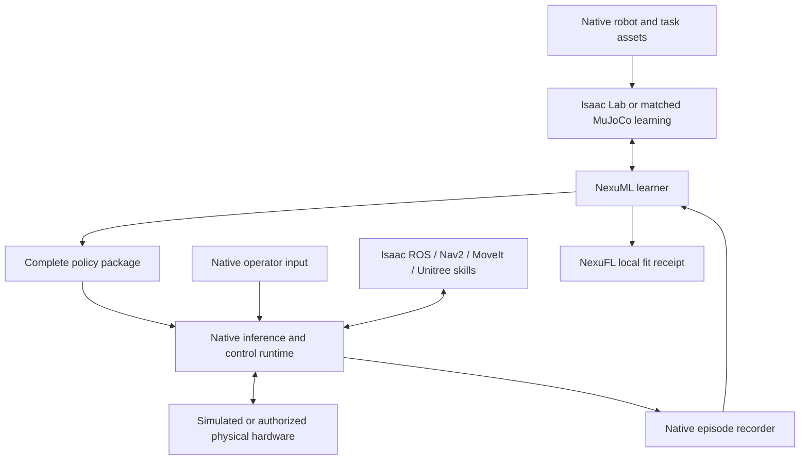

# Design

## Scope and dependencies

Consume the small qualified interaction/inference handoff (foundation tasks 1.7–1.8) and relevant native environment gate in decouple-simulation-learning-and-evaluation. Do not wait for every Ray/GPU, optional simulator or hardware task. The foundation owns generic simulator contracts, native learning/collection, play/viewers, evaluation, portable policy and local fit. This change owns actual robotics integration and the selected example deliveries; the broader add-isaac-physical-ai-backend retains algorithms, dataset quality, safety, VLA, benchmark and other embodiment obligations. Reuse evidence from umbrella §§7–9, 12–13, 16, 19–21 and foundation; do not create duplicate queues. Prioritize LeKiwi and G1 after small native smoke references; unrelated earlier roadmap robots remain planned, not prerequisites for G1.

## 1. Learning versus full-stack simulation



A. High-throughput native vectorized learning: use native tensors, do not route each parallel RL environment through ROS/DDS. Native tasks remain independently runnable. B. Deployment-equivalent system test: run actual deployment software against small simulated systems, using native ROS launch, ros2_control, Isaac Sim ROS bridge, Gazebo or official Unitree DDS simulation. Preserve compatible controller and policy interfaces, replace only hardware transport/driver and explicit clock/calibration config. Keep native vendor control where ROS is not the appropriate abstraction. Validate TF, /clock versus wall/monotonic time, timestamps/QoS, freshness, controller timing, lifecycle, namespaces/ROS_DOMAIN_ID and native DDS domain/interface isolation. Simulated and physical destinations must be unambiguous and isolated; native Unitree simulators can use the same message interfaces as real robots. Test no physical command, repeat startup/shutdown, stale state, controller loss, deadlines, cancel and cleanup. Use native launch/process lifecycle through existing execution dispatch; no generic launch supervisor or second simulator in learning actors. Preserve independent live Gazebo/ros2_control acceptance.

## 2. Native robot runtime and hierarchical skills

Extend existing library ROS transport seams minimally: typed standard observation subscriptions, bounded commands, service/action clients. Record message type, units, frame, calibration, endpoint, timestamps, freshness and failures. Native DDS/Unitree SDK2 is a peer provider; use approved SDK/firmware interface rather than force all low-level calls through ROS. Load complete policy without learner or simulator in inference-only mode. Physical execution is explicitly authorized; simulation play/teleop never implicitly connects to hardware.

Reuse existing ActionAdapterDefinition and runtime boundary for optional typed native Nav2 goals, MoveIt 2/collision-aware pose/trajectory requests and qualified G1 locomotion/upper-body/whole-body commands. Asynchronous skill identity, accepted/rejected/running/succeeded/failed/cancelled status, duration, result, timeout and cancellation are explicit. Do not block a real-time control loop or treat variable-duration goals as fixed-step RL without qualified objective/time semantics. Native classical planners, balance and motor controllers remain responsible for control; independent safety/watchdog/stop and fallback remain outside neural action bounds. PX4 remains the separate existing SITL roadmap, not a G1 or LeKiwi dependency.

## 3. Teleoperation, data and ownership

Reuse Isaac Lab/Arena teleop/recorders, LeIsaac/LeRobot for LeKiwi/leader arms, and Unitree XR or compatible NVIDIA Physical AI G1 tools. Keyboard/gamepad/SpaceMouse/leader/XR are provider capabilities, not mandatory for every embodiment. Thin public CLI and callable SDK for teleop and optional recording; no new UI or custom device protocol. Illustrative syntax (not current API):

```bash
nexuml teleop --scenario-file lekiwi.py --input gamepad --viewer viser --record ./episodes
nexuml teleop --scenario-file g1.py --input xr --viewer webrtc --record ./episodes
nexuml train --scenario-file imitation.py
nexuml play ./policy --viewer local
```

One authorized action owner per controlled resource (human, scripted expert, classical controller, loaded policy), with explicitly permitted coordinated controller interfaces. Use native arbitration/retargeting, explicit human takeover and logged interventions; reject simultaneous conflicting control, stale replay, arbitrary code and unauthorized physical commands. Record requested and executed actions separately, timestamp/clock domain, sensor data, calibration, outcomes, actor/controller version, source and episode boundaries. Remote viewer does not supply input transport: reuse native remote input such as LeIsaac's leader route or Unitree XR; document operator-managed private network, measure input-to-command latency/freshness and deadman/disconnect stop or hold. No VPN, forwarding or desktop provisioning. Physical reset is not assumed.

Reuse native HDF5/rosbag2 MCAP/LeRobot recorders/converters and existing LeRobotDataSource. Preserve original recordings; validate alignment, rates, masks, missing frames, calibration and actual action/outcome. Keep derived Mimic demonstrations grouped with their source for splits; label scripted, generated, human and correction data independently. Existing BC/ACT and other IL models use ordinary learner/loader/export; require held-out closed-loop results, reuse DAgger/Mimic/ACT acceptance. No automatic data upload; keep private experience local.

## 4. Perception and learning integration

Use existing pipeline/components and semantic contracts. Three arrangements: (1) external/frozen Isaac ROS pose/localization/detection/feature outputs are structured observations; separately train perception through ordinary supervised workflow if required; (2) trainable PyTorch vision encoder + policy in same learner with explicit gradient/optimizer and frozen/trainable scope; (3) hybrid learned policy with native planners/controllers. ROS/TensorRT inference is not automatically differentiable. Prove sensor/feature parity, missing-data behavior, latency and outcome comparison. Privileged oracle observations may be teacher/critic inputs but never deployed actor inputs. Preserve explicit shared/frozen/private parameter manifest for NexuFL. Reuse maintained FoundationPose or equivalent, cuVSLAM/nvblox and Nav2; optimized Isaac ROS Deploy/LEAPP/ONNX/TensorRT only for qualified artifacts and complete processor/state/action parity.

## 5. Native dependencies and accelerated transport

Umbrella currently targets Isaac ROS 5.0/Lyrical; probe a maintained compatible release (including 5.1 reference workflow) against pinned Sim 6.2/Lab 3.0, SDK2 and available CUDA/driver/Ubuntu/Python. Separate incompatible ROS/Kit workspaces or images only with actual standard-message/QoS/clock/ABI wire evidence. Native deps remain optional, no hidden override or import-time system installer. Reuse CI image/runtime profile workflow.

First qualify ordinary ROS messages. Investigate standard rosidl::Buffer CUDA backend and maintained tensor/PyTorch interop, not removed NITROS APIs. Prove dtype/layout, device/host residency, ownership/lifetime, stream/thread synchronization and stale/malformed input handling. Measure copies, latency distribution, memory/throughput and output parity versus same workload over standard ROS. Optional accelerated path explicitly selected/negotiated; normal-message fallback explicit, never labeled zero-copy. No inter-node zero-copy assumption. Unsupported acceleration may be blocked independently of standard ROS and G1 workflows.

## 6. Selected catalogue and physical G1

All R01–R10 in reference-catalogue.md are mandatory Isaac-based deliverables. Reuse exact upstream tasks first; where only assets exist, author minimal native task code and a real reward-bearing or demonstration-based learning objective. Keep native robot/config/asset code in reference modules or optional project-owned package, not generic core branches. Avoid committing large/third-party restricted binaries; record resolver/cache, source revisions, hashes, licenses and asset dependencies. Require known-action/terminal/reset proofs, actual finite changed parameters, resume/export/reload, held-out task outcomes, play and cleanup. Asset loading, scripted motion, teleop or upstream training alone is insufficient. Distinguish small smoke from frozen quality protocols. No need for every asset under every Isaac physics backend, viewer or alternate simulator.

LeKiwi V1 is the primary mobile simulation reference. Inspect official URDF/meshes/calibration and LeIsaac model/task first; verify three-wheel holonomic kinematics and actual SO-101 arm/gripper controls. Classical navigation and motion planning baseline, learned reach/contact grasp/place, integrated navigate/pick/transport/place system workflow with success/failure/collision evidence. Human simulation teleop, recording and IL required; physical LeKiwi optional. R04 Kaya and R05 RidgebackFranka exercise related base/arm interfaces but do not replace LeKiwi.

G1 29-DoF body is primary, matching intended EDU and official Unitree G1 29-DoF workflow. 23-DoF locomotion variant optional, separate contract. NVIDIA catalogue's G1 asset includes additional articulated joints; do not equate total simulated DoFs and body controls. Pin exact body, hands, calibration, firmware and control mapping. Reuse unitree_rl_lab for locomotion, unitree_sim_isaaclab for manipulation/DDS, unitree_mujoco for matching simulation, xr_teleoperate/unitree_lerobot or qualified NVIDIA Isaac ROS Physical AI for demonstrations and whole-body control. Audit native release compatibility before use. Require learned locomotion and separate contact manipulation/IL with human demos, LeRobot conversion, BC/ACT or compatible policy, export, held-out closed-loop replay, fall/tracking/grasp evidence. Verify matching Isaac/MuJoCo sim-to-sim and isolated native DDS system loop. Retain qualified native balance/whole-body control for initial upper-body manipulation, not simultaneous unsafe low-level controller replacement.

G1 EDU is the first physical target, exact variant/hands/compute/firmware/SDK access subject to confirmation. Physical readiness: recorded-input parity, sim-to-sim/full-stack controller failure proof, qualified native control, calibrated sensors, manufacturer-approved support/protective area, independent stop/fallback, operator enablement. Only separately authorized supervised bounded manipulation and recording; no unattended exploration, automatic physical RL, mid-episode weight swap or automatic promotion. Hardware absent means physical gate blocked, not all software blocked. Feed approved G1 recordings to foundation matched Isaac/MuJoCo/real common actor local-fit and mixed-objective evidence. LeKiwi/G1 full action heads not interchangeable. NexuFL owns aggregation/transport/fleet versioning.

## 7. Implementation boundaries

Reuse existing core types, interaction, evaluation/play, CLI/SDK, library ROS transport, LeRobot loaders and native task registries. Library owns optional ROS/Unitree/skill/teleop/record adapters; native robot-specific assets and launch remain in reference package/modules. Reuse Ray Jobs for independent remote simulator/teleop where supported, no local fallback, external input/network owned by operator. Real-time control and safety local to robot, independent of Ray, NetBird and NexuFL. No sibling-repo changes.

## References

See reference-catalogue.md for robot sources. Integration sources (resolve/pin before implementation):
- https://nvidia-isaac-ros.github.io/
- https://docs.isaacsim.omniverse.nvidia.com/6.2.0/installation/install_ros.html
- https://docs.nav2.org/
- https://moveit.picknik.ai/
- https://control.ros.org/
- https://docs.ros.org/
- https://lightwheelai.github.io/leisaac/docs/getting_started/teleoperation/
- https://nvidia-isaac-ros.github.io/reference_workflows/isaac_for_physical_ai/tutorials/tutorials.html
